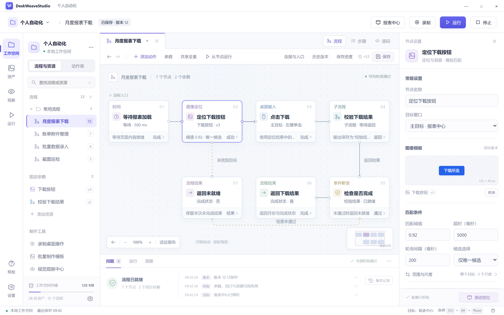

# DeskWeaveStudio

[](LICENSE)
[](ROADMAP.md)
[](docs/architecture/platforms.md)
[](docs/interfaces/mcp.md)

[](docs/architecture/system.md)
[](docs/design/studio.md)
[](docs/design/studio.md)
[](.github/workflows/docs.yml)

**A visual workspace for desktop automation.**

DeskWeaveStudio is designed to record desktop actions, compose workflows, locate screen targets and debug task execution. Workflows use a public JSON format shared by the desktop workspace, command line and MCP clients.

[中文](README.md) · [Documentation (Chinese only)](docs/README.md) · [Interface prototypes](#interface-prototypes) · [Roadmap (Chinese only)](ROADMAP.md) · [Contributing (Chinese only)](CONTRIBUTING.md)

## Project status

The execution core is under development. The Python service library provides expression previews, workflow validation, inline workflow version storage, catalog and revision pagination, and saved-request lookup. The repository also contains system designs, interactive prototypes, high-resolution mockups and public contracts. The desktop application, standalone Engine process, Rust Agent, MCP Bridge and installers follow the [roadmap (Chinese only)](ROADMAP.md).

## Execution core

With Python 3.12 and uv 0.8.2:

```bash
uv sync --frozen
uv run --frozen python examples/engine/workspace.py
```

The example saves, reads and validates a workflow and previews an expression in a temporary workspace. See [Engine development (Chinese only)](docs/development/engine.md) for available methods and development commands.

## Interface prototypes



The prototypes cover workspaces, graph, step and source editors, recording, target selection, assets, run debugging, observation, settings and recovery flows.

With Python 3.12 or later, start the preview from the repository root:

```bash
python tools/serve_prototypes.py
```

Open the local address printed by the command in your browser. Press `Ctrl+C` to stop the server. On Linux/macOS, use `python3` if needed. You can also open the [prototype entry file (Chinese only)](docs/prototypes/index.html) directly in a local browser.

[High-resolution mockups (Chinese only)](docs/design/high-fidelity.md) · [Screen catalog (Chinese only)](docs/design/prototypes.md) · [Prototype guide (Chinese only)](docs/prototypes/README.md)

## Planned capabilities

- **Workflow authoring:** edit one document through graph, step and source views, with parameters, conditions, bounded loops, shared run variables and subworkflows.
- **Recording across all displays:** capture continuous keyboard and pointer input across mixed scaling, portrait displays, negative coordinates and irregular layouts. Preserve intermediate positions, timing and held input for continuous drawing across displays and timeline editing.
- **Targeting and templates:** select windows or screenshot regions, test template matching, extract candidates in batches and name them through OCR, rules or manual input.
- **Execution and debugging:** run fixed workflow versions, set breakpoints, step through execution, inspect variables, start from a selected node, pause, resume, stop and trigger an emergency stop.
- **Continuous observation:** monitor targets, detect changes, filter records by time and export screenshots and results. Configure optional vision models through separate connections.
- **Assets and versions:** manage workflows, image templates, input trajectories, revision history and portable task packages; recover drafts and back up workspaces.
- **MCP integration:** target 2026-07-28 with 2025-11-25 compatibility; expose tools, resources and prompts through stdio or explicitly enabled network transports, with filtered cursor queries and shared business logic, workspace state and desktop control.

See [product requirements (Chinese only)](docs/product/requirements.md) for the full scope and usage scenarios, and the [feature map (Chinese only)](docs/design/feature-design-map.md) for design, prototype and acceptance references.

## Architecture

Studio, MCP and the command line share one workspace Engine for business validation, save transactions, paginated queries and run state. Each open workspace has one Engine; one Rust Desktop Agent schedules input for each interactive desktop.

| Component | Technology choice | Responsibility |
|---|---|---|
| Studio | Tauri 2.12, React 19.3, TypeScript | Workspace UI, native windows, editing interactions and Engine client |
| Engine | Python | Shared application services, workflow execution, workspace storage and vision tasks |
| Desktop Agent | Rust | Target sessions, screen capture, continuous input scheduling, recording and emergency stop |
| MCP Bridge | Python | MCP protocol, client authorization binding and Engine method mapping |
| CLI | Python | Command arguments, result output and Engine method mapping |

The platform design covers Windows, macOS and Linux. Linux X11 and Wayland handle input, recording and system permissions separately. Display coverage, recording and input capabilities are detected for the active desktop backend; see the [cross-platform design (Chinese only)](docs/architecture/platforms.md) and [release matrix (Chinese only)](docs/operations/release.md).

See the [system architecture (Chinese only)](docs/architecture/system.md) and [shared application services (Chinese only)](docs/architecture/shared-services.md) for component relationships and request handling.

## Documentation

The linked design documents and project guides are Chinese only. Public contracts use English identifiers and include examples for client implementers.

| Goal | Starting points (Chinese only) |
|---|---|
| Implement workflow editing and execution | [Workflow model](docs/design/workflow.md), [frontend structure](docs/design/studio.md), [execution control](docs/design/execution.md) |
| Implement recording and continuous input | [Recording across all displays](docs/design/recording.md), [pointer motion and drawing](docs/design/pointer-motion.md) |
| Integrate services or build clients | [Local protocol](docs/interfaces/local-protocol.md), [MCP interface](docs/interfaces/mcp.md), [command line](docs/interfaces/command-line.md), [pagination](docs/interfaces/pagination.md) |
| Design interfaces and interactions | [Interaction design](docs/design/experience.md), [visual system](docs/design/visual-system.md), [accessibility](ACCESSIBILITY.md) |
| Inspect formats and examples | [Contracts](docs/README.md#机器可读资料), [examples](examples/README.md), [content transfer](docs/interfaces/content-transfer.md) |
| Develop, test and release | [Engineering](docs/development/engineering.md), [verification](docs/quality/verification.md), [releases](docs/operations/release.md) |

## Local checks

Use Python 3.12 or later and create an isolated environment from the repository root.

Windows PowerShell:

```powershell
python -m venv .venv-docs
.\.venv-docs\Scripts\python.exe -m pip install -r requirements-docs.txt -r requirements-prototypes.txt
.\.venv-docs\Scripts\python.exe tools/check_docs.py --contracts
.\.venv-docs\Scripts\python.exe tools/check_prototypes.py
```

Linux/macOS:

```bash
python3 -m venv .venv-docs
.venv-docs/bin/python -m pip install -r requirements-docs.txt -r requirements-prototypes.txt
.venv-docs/bin/python tools/check_docs.py --contracts
.venv-docs/bin/python tools/check_prototypes.py
```

These commands check documentation links, public contracts, examples, the prototype catalog and image files. The complete command list, including checks that require Node.js 22, is in the [engineering guide (Chinese only)](docs/development/engineering.md). See [prototype validation (Chinese only)](docs/quality/prototype-validation.md) for page and interaction checks.

## Contributing

Use the repository's Issue forms for bugs, feature requests and design discussions. Read the [contribution guide (Chinese only)](CONTRIBUTING.md) and [code of conduct (Chinese only)](CODE_OF_CONDUCT.md) before submitting changes. Report vulnerabilities and sensitive information through the [security process (Chinese only)](SECURITY.md).

## License

Project-authored source code, documentation, contracts and original examples are licensed under the [Apache License 2.0](LICENSE) (`Apache-2.0`). Third-party dependencies and materials retain their respective licenses. See [licensing details (Chinese only)](LICENSING.md) for distribution requirements.
