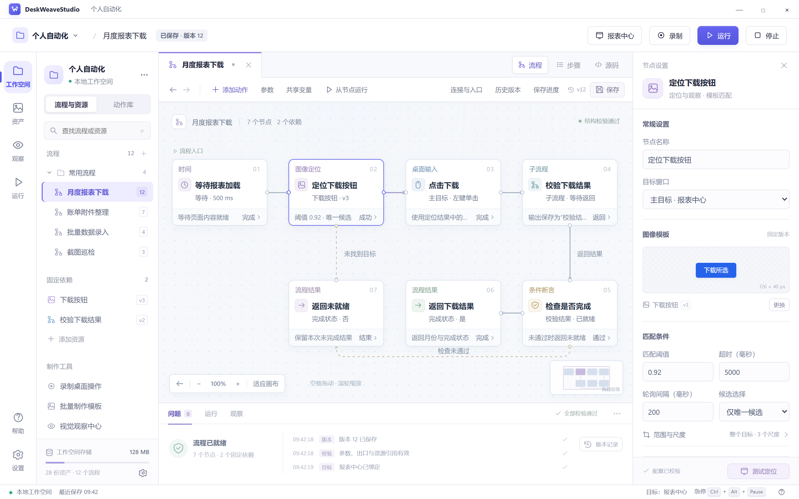

# DeskWeaveStudio

[](LICENSE)
[](ROADMAP.md)
[](docs/architecture/platforms.md)
[](docs/interfaces/mcp.md)

[](docs/architecture/system.md)
[](docs/design/studio.md)
[](docs/design/studio.md)
[](.github/workflows/docs.yml)

**织序工作台 · 可视化桌面自动化**

DeskWeaveStudio 聚焦全显示屏跨屏录制、连续轨迹还原、图像定位和流程编排，让桌面操作成为可编辑、可调试、可复用的流程。工作台、命令行与 MCP 客户端使用同一份流程与资产。

[English](README.en.md) · [文档导航](docs/README.md) · [界面原型](#界面原型) · [路线图](ROADMAP.md) · [参与开发](CONTRIBUTING.md)

## 当前状态

项目进入执行核心开发阶段。Python 服务库已提供表达式预览、流程校验、流程版本保存与读取、内容分块传输、目录及历史分页、原请求查询、连接认证内核、原生本机通道与独立 Engine 服务进程。系统设计、交互原型、高清效果图和公共契约随仓库提供。桌面应用、跨宿主启动协调、Rust Agent、MCP Bridge 与安装包按[路线图](ROADMAP.md)实施。

## 执行核心

使用 Python 3.12 和 uv 0.8.2：

```bash
uv sync --frozen
uv run --frozen python examples/engine/workspace.py
```

示例在临时工作空间执行保存、读取、校验和表达式预览。大流程的分块上传、资源读取和释放见[内容传输示例](examples/engine/content_transfer.py)，运行 `uv run --frozen python examples/engine/content_transfer.py`。独立进程示例运行 `uv run --frozen python examples/engine/process.py`，完成受控启动、保存和重连查询。方法范围和开发命令见[Engine 开发](docs/development/engine.md)。

## 界面原型



原型涵盖工作空间、流程画布、步骤与源码编辑、录制与定位、资产、运行调试、观察、设置及异常恢复。

使用 Python 3.12 或更高版本，在仓库根目录启动预览：

```bash
python tools/serve_prototypes.py
```

在浏览器中打开命令输出的本机地址，按 `Ctrl+C` 停止服务。Linux/macOS 可使用 `python3`；也可以在本地用浏览器直接打开[原型入口文件](docs/prototypes/index.html)。

[高清效果图](docs/design/high-fidelity.md) · [全界面图册](docs/design/prototypes.md) · [原型使用说明](docs/prototypes/README.md)

## 功能设计

- **流程制作**：流程画布、步骤列表和源码编辑同一份文档，支持参数、条件、有界循环、运行共享变量与子流程。
- **全显示屏录制**：连续录制键鼠操作，处理混合缩放、横竖屏、负坐标与异形布局，保留轨迹中间位置、时序和按住状态，支持跨屏连续绘制及时间轴编辑。
- **定位与模板**：选择窗口或截图区域，测试模板匹配，批量提取候选并通过 OCR、规则或手工方式命名。
- **运行与调试**：使用固定版本运行任务，设置断点、单步执行、查看变量、从指定节点启动，并提供暂停、继续、停止与全局急停。
- **持续观察**：按周期观察目标、检测变化，按时间筛选记录并导出截图和结果；视觉模型通过独立连接配置。
- **资产与版本**：管理流程、图像模板、输入轨迹、历史版本和便携任务包，恢复草稿及备份工作空间。
- **MCP 接入**：主协议为 2026-07-28，兼容 2025-11-25；通过 stdio 或显式启用的网络服务访问工具、资源与预设任务，按条件分页查询集合，共用业务逻辑、工作空间状态和桌面控制。

完整范围与使用场景见[产品需求](docs/product/requirements.md)，各能力的设计、原型和验收入口见[功能映射](docs/design/feature-design-map.md)。

## 系统架构

工作台、MCP 和命令行共用同一个工作空间 Engine，由它统一处理业务校验、保存事务、分页查询和运行状态。每个打开的工作空间一个 Engine；同一交互桌面的输入由一个 Rust Desktop Agent 调度。

| 组件 | 技术方案 | 主要职责 |
|---|---|---|
| Studio | Tauri 2.12、React 19.3、TypeScript | 工作台、原生窗口、编辑交互与 Engine 客户端 |
| Engine | Python | 共享应用服务、流程解释、工作空间存储和视觉任务 |
| Desktop Agent | Rust | 目标会话、屏幕采集、连续输入调度、录制和急停 |
| MCP Bridge | Python | MCP 协议、客户端授权绑定与 Engine 方法映射 |
| CLI | Python | 命令参数、结果输出与 Engine 方法映射 |

平台设计覆盖 Windows、macOS 和 Linux；Linux X11 与 Wayland 分别处理输入、录制和系统授权。显示覆盖、录制与输入能力按当前桌面后端检测，具体组合见[跨平台设计](docs/architecture/platforms.md)和[发行矩阵](docs/operations/release.md)。

组件关系与调用链见[系统架构](docs/architecture/system.md)及[共享应用服务](docs/architecture/shared-services.md)。

## 文档入口

| 你的目标 | 阅读入口 |
|---|---|
| 实现流程编辑与执行 | [流程模型](docs/design/workflow.md)、[前端结构](docs/design/studio.md)、[运行控制](docs/design/execution.md) |
| 实现录制与连续输入 | [全显示屏录制](docs/design/recording.md)、[连续指针与笔画](docs/design/pointer-motion.md) |
| 接入服务或开发客户端 | [本机协议](docs/interfaces/local-protocol.md)、[MCP 接口](docs/interfaces/mcp.md)、[命令行接口](docs/interfaces/command-line.md)、[分页查询](docs/interfaces/pagination.md) |
| 设计界面与交互 | [交互设计](docs/design/experience.md)、[视觉系统](docs/design/visual-system.md)、[无障碍要求](ACCESSIBILITY.md) |
| 检查公共格式与示例 | [契约目录](docs/README.md#机器可读资料)、[示例说明](examples/README.md)、[内容传输](docs/interfaces/content-transfer.md) |
| 开发、测试与发行 | [工程实施](docs/development/engineering.md)、[验证设计](docs/quality/verification.md)、[发行设计](docs/operations/release.md) |

## 本地检查

使用 Python 3.12 或更高版本，在仓库根目录建立独立环境。

Windows PowerShell：

```powershell
python -m venv .venv-docs
.\.venv-docs\Scripts\python.exe -m pip install -r requirements-docs.txt -r requirements-prototypes.txt
.\.venv-docs\Scripts\python.exe tools/check_docs.py --contracts
.\.venv-docs\Scripts\python.exe tools/check_prototypes.py
```

Linux/macOS：

```bash
python3 -m venv .venv-docs
.venv-docs/bin/python -m pip install -r requirements-docs.txt -r requirements-prototypes.txt
.venv-docs/bin/python tools/check_docs.py --contracts
.venv-docs/bin/python tools/check_prototypes.py
```

以上命令检查文档链接、公共契约、示例、原型目录和图像文件。包含 Node.js 22 检查项的完整命令见[工程实施](docs/development/engineering.md)；页面与交互检查见[原型检查](docs/quality/prototype-validation.md)。

## 参与开发

缺陷、功能提议和设计讨论使用仓库对应的 Issue 表单；提交变更前阅读[贡献指南](CONTRIBUTING.md)与[协作约定](CODE_OF_CONDUCT.md)。漏洞和敏感信息按[安全报告流程](SECURITY.md)处理。

## 许可

项目自有源码、文档、契约和原创示例采用 [Apache License 2.0](LICENSE)（`Apache-2.0`）。第三方依赖与素材保留各自许可证，分发要求见[许可说明](LICENSING.md)。
