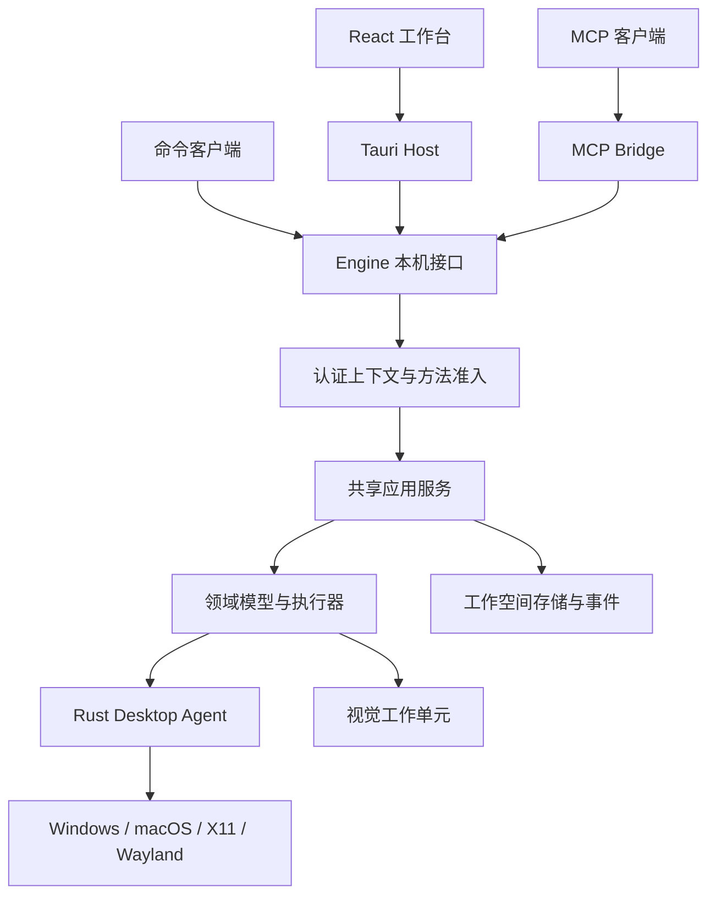

# 共享应用服务与多入口

## 调用结构

Studio 的 React 工作台、MCP 和 CLI 使用同一个工作空间 Engine。业务方法在 Engine 内只有一套处理器，工作空间数据只有一个写入者；所有桌面输入经同一个 Rust Agent 调度。

工作台使用 Tauri WebView 加载 React 静态资源；Vite 开发服务器只提供前端资源。独立浏览器访问的原型位于 docs/prototypes，其内存数据和模拟交互用于页面设计。正式工作台通过 Host 连接 Engine，原型脚本不作为生产执行器或 MCP 服务导入。

Engine 可由工作台或命令启动器启动；MCP 不依赖工作台窗口保持打开。启动器按[生命周期](lifecycle.md)连接或启动该工作空间的唯一实例。Bridge 重启只恢复协议连接，不能另外创建工作空间数据库、解释器或运行状态。

## 职责分层

| 层 | 负责内容 | 下游接口 |
|---|---|---|
| React 编辑与展示 | 源码缓冲、编辑事务、撤销、选择、布局、字段结构反馈及服务状态投影 | 生成的服务客户端与 Host 窗口接口 |
| Tauri Host | 可信窗口身份、本地选择与确认、进程连接、内容和事件桥接 | Engine 本机接口；独立原生急停路径 |
| MCP Bridge | 协议解析、工具与资源映射、认证委托、进度和取消关联、结果封装 | Engine 本机接口 |
| Engine 应用服务 | 方法准入、对象授权、参数归一化、版本冲突、事务、查询、作业与运行控制 | 领域服务、存储和外部端口 |
| Python 领域层 | 流程语义、表达式、依赖解析、动作执行、控制流和预算 | 桌面、视觉、模型端口 |
| Rust Agent | 租约、原生输入、连续轨迹调度、录制、坐标适配、输入释放和急停 | 平台后端 |

Host 与 Bridge 可以提前拒绝不合法消息，但 Engine 仍完整执行准入与业务校验。前端按钮状态、MCP 工具注解和客户端传入的 valid 字段都不代替 Engine 判断。

packages/workflow 保存 TypeScript 文档类型、编辑补丁和纯投影。语法解析和 Schema 校验可在 worker 中提供即时反馈；可执行性、图与资源闭包、表达式求值、权限及预算由 Engine 最终计算。表达式编辑器保存 AST；求值预览调用 expression.preview，与运行使用同一个领域求值器。布局、文本编辑和选择不需要往返 Engine。

## 方法与契约

[服务 Schema](../../contracts/service.schema.json)定义业务方法、参数与结果；[MCP 目录](../../contracts/mcp-catalog.json)和[CLI 目录](../../contracts/cli-catalog.json)只声明入口映射、参数装配和公开权限。Studio 的 TypeScript 方法联合与请求/结果类型从服务 Schema 生成，Host 和 Bridge 使用同一方法目录限制分发。

Engine 使用单一处理器注册表。启动时核对服务方法与处理器一一对应；缺失或重复注册拒绝就绪。处理器绑定方法准入、参数规范化、对象校验及执行函数，不按 studio、mcp 或 cli 分别注册业务版本。各入口通过认证上下文表达合法差异。

| 业务 | 共用方法与规则 |
|---|---|
| 流程读取、校验和保存 | workflow.read/validate/save/revisions；相同定义、依赖、诊断和版本事务 |
| 表达式预览与运行求值 | 本地编辑使用 expression.preview；预览和各入口启动的运行共用领域求值器与类型规则 |
| 运行准备与控制 | run.prepare/start/pause/resume/stop/snapshot；相同计划、控制版本、状态机和清理 |
| 单次输入与流程动作 | input.submit 创建临时运行；与流程动作使用相同领域处理器和 Agent 调度 |
| 采集、匹配与模板 | capture.create、vision.match、template.*；相同来源、候选、命名和原子提交 |
| 观察 | vision.observe、observation.*；相同连接版本、周期、取消和记录 |
| 资产制作 | asset.*、content.*；相同来源版本、内容校验、名称与引用检查 |
| 查询 | workspace.catalog、query.* 及各对象分页方法；相同筛选、排序、快照与容量 |
| 作业、事件和请求恢复 | operation.*、request.status、event.*、stream.*；相同对象状态及访问规则 |
| 平台能力与轨迹 | system.capabilities；输入和轨迹统一经 Engine 与 Agent 检查当前后端 |

录制、目标选择、系统设置、模型连接管理、令牌管理、草稿、表达式编辑预览以及输入恢复确认保留可信本地入口。它们同样调用 Engine 方法；MCP 对已授权轨迹资产的读取与回放共用已有服务。本地能力由 Engine 按目录和认证上下文限制，不能通过公开工具、资源、CLI 参数或原请求查询间接取得。

## 认证上下文

每次派发关联工作空间、稳定客户端身份、连接代次、入口类别、已授予能力、授权版本、请求身份和截止预算。工作空间与客户端身份来自 Engine 核验过的连接；业务 params 和 MCP 元数据只能提供允许的请求字段，不能选择角色、权限或其他客户端。

Bridge 的本机连接认证桥接进程身份。每个 MCP 客户端仍使用独立、经 Engine 核验的委托上下文，绑定原令牌或本地授权、对象范围及撤销状态。不得把全部 MCP 调用合并为 Bridge 的管理身份。撤权后既有连接、资源、查询和新命令按同一授权版本停止访问。

共享数据不合并拥有者。工作台可按 run.read 查看获准运行，但不能把 MCP 所属作业或查询改成自己的对象。operation.get/cancel、request.status、内容暂存和查询游标继续核对原拥有者；本地管理权限不自动扩大业务数据读取权。

## 单次命令处理

1. 入口解析协议、校验可发布参数，并建立已认证请求上下文。本地禁入字段在派发前拒绝，不能删除后继续执行。
2. Engine 核对方法暴露范围、角色、工作空间及对象权限，再按共享 Schema 检查参数。
3. 方法处理器应用确定性的契约默认值和归一化规则。Schema 的 default 只是声明，实际补值由公共实现执行；false、0、空串与 null 按各自字段含义保留。
4. Engine 固定方法和规范参数的请求摘要，查询原请求或登记新意图。环境配置、目标及依赖在本次准入时固定；重查原请求不按当前设置重算原运行。
5. 领域服务完成语义检查；写入事务再次核对权限及预期版本，登记状态和事件。长作业返回原 operationId，运行返回原 runId。
6. 结果按原方法 Schema 验证。Host 提供界面投影，Bridge 封装 MCP 内容；两者都不重新计算 valid、canCommit、选中候选、运行终态或输入清理结果。

MCP 资源 URI 的字段装配属于协议适配。固定资源类型、字段转换和默认值必须在目录中明确；有服务默认值的字段与服务一致。未知字段、重复查询键、无效数字或数组编码拒绝，不静默改成默认筛选。只调用一次对应 Engine 查询，不先取全部结果再在 Bridge 分页。

## 请求恢复与取消

Engine 使用工作空间、稳定客户端和请求 ID 去重。同一请求 ID 的方法或规范参数变化返回 REQUEST_CONFLICT；不同客户端或新意图不因参数相同而合并。

MCP 的 JSON-RPC ID、旧版协议 session 和 Engine 请求 ID 分开。2026-07-28 逐请求适配与 2025-11-25 会话适配共用一个服务目录，协议元数据、订阅和结果信封由 Bridge 转换。新版 HTTP 响应流断开进入请求取消，旧版断开只结束等待；业务状态均从 Engine 查询。可恢复调用在 params._meta 的 deskweave/requestId 中提供预先生成的请求身份，Bridge 映射到本机信封 id；结构与重连步骤见[MCP 接入](../interfaces/mcp.md#请求身份与恢复)。新版在未完成请求集合中检查 JSON-RPC ID 重号，旧版按其会话规则处理。

Bridge 仅维护协议请求与 Engine 请求的关联，不自行保存第二份业务收据。取消定位原请求或作业，进入共享取消与输入清理路径；传输取消只结束等待时，业务终态仍从原对象查询。重连不会把未确认操作改为未执行，也不会自动重新发送输入。

## 状态同步与并发

Engine 的提交状态、版本和有序事件是所有入口的权威来源。工作台缓存按工作空间、认证身份、授权版本和对象版本隔离；Bridge 只缓存已获准的发现信息及传输状态。查询游标绑定其读取者，不在两个入口间交换使用。

例如 MCP 保存流程新版本时，Studio 的历史查询刷新该版本；未保存的本地草稿保留，下一次保存以 baseRevision 比较并处理冲突。MCP 启动运行后，获准工作台读取同一 runId 的快照；工作台暂停该运行后，MCP 读取同一控制版本和暂停状态。查看窗口不会接管对象所有权。

流程保存、运行控制和资产提交均以服务端版本比较；前端先读后写的检查不能替代事务内比较。事件缺口、连接 epoch 变化和撤权按[本机协议](../interfaces/local-protocol.md)重新同步，不把迟到结果拼接到新查询或新文档。

## 桌面能力

连续鼠标移动、拖拽、轨迹回放与跨屏转换统一在 Rust Agent 中执行。前端动画、MCP 请求批次和 Python 计时器不代替原生逐点调度。录制保留全部中间位置、顺序和时间；回放验证目标窗口在移动过程中接收并绘制路径。规则见[连续指针设计](../design/pointer-motion.md)。

各入口读取同一平台能力摘要。Wayland 输入控制、视频采集与全局被动录制分别准入；MCP 不能因使用不同传输绕过后端、显示范围、租约或系统授权限制。完整规则见[跨平台架构](platforms.md)。

## 实现顺序与验证

M1 建立 Engine 处理器注册表、统一上下文和领域服务；M2 的工作台接入同一客户端契约；M4 将 MCP 工具、资源与 CLI 接入并完成 Q59。应用注册表检查各方法只有一个实现；模块依赖检查禁止 UI、Host、Bridge 和 CLI 直接访问工作空间存储或原生输入实现。

文档阶段检查方法覆盖、输入/结果引用、公开参数投影、资源参数装配、默认值和多入口权限一致性。Q59 在实际组件中比较相同工作空间、对象版本、业务参数及等价权限下的业务结果，同时覆盖正常权限差异、跨入口并发、断线恢复、取消与分页。随机对象身份、客户端专属游标及连接时间不要求相等；诊断、已提交版本、状态转换、完整路径与访问控制必须一致。
