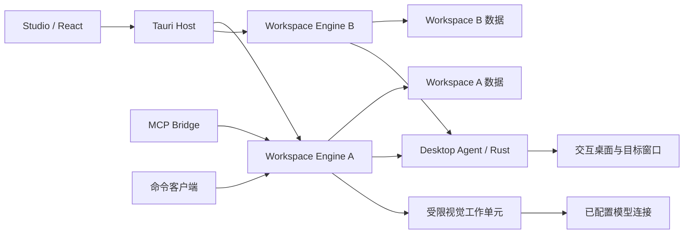

# 系统架构

## 部署结构

Studio 是桌面客户端。每个打开的工作空间由一个 Engine 进程提供文档、执行和存储服务；一个交互桌面只有一个 Desktop Agent。多个 Engine 可以并行处理文件或图像，但必须向同一个 Agent 申请输入。



## 责任与所有权

| 组件 | 权威对象 | 主要接口 |
|---|---|---|
| React Studio | 本地编辑会话、选中项、布局和待提交命令 | 文档操作、运行订阅、受控资源 |
| Tauri Host | 窗口身份、原生选择对话框、客户端权限 | 受限 invoke、资源桥、窗口生命周期 |
| Workspace Engine | 工作空间数据库、流程版本、运行状态和事件 | 本机命令、事件、资产流 |
| Desktop Agent | 桌面租约、输入台账、目标系统身份、采集时钟 | acquire/release、输入段、录制、截图、急停 |
| 视觉工作单元 | 本次计算输入和结果 | match、extract、observe |
| MCP Bridge | 客户端协议会话与已授予能力 | MCP 工具、资源和订阅 |
| 命令客户端 | 参数装配、原请求定位和输出 | 具名 CLI 命令映射到同一 Engine 服务 |

Engine 是工作空间唯一写入者。Studio、Bridge 和工作单元不直接写数据库。Agent 不解析工作流、不运行脚本、不访问模型凭据。Tauri Host 不重新实现流程解释器。

工作台、MCP 和 CLI 通过同一应用服务处理业务校验、对象权限、默认值、事务、查询和运行状态。共享范围包括处理器与状态，不能仅以共用 Schema 替代。前端编辑、协议适配和本地权限的边界见[共享应用服务](shared-services.md)。

## 进程与发现

Engine 单实例键包含用户、工作空间规范路径、实际目录对象和工作空间身份；同一工作空间的多个窗口与命令客户端连接同一进程。Agent 单实例键包含登录用户、系统会话与交互桌面，不包含程序版本、工作空间或窗口。

启动器先连接并核验实际进程，再争用启动锁；只有锁拥有者创建缺失实例。发现记录只提供定位，不授予权限。连接经身份核验、版本协商和认证后，才进入文档服务就绪；输入还要求 Agent、目标和急停入口分别就绪。

同一机器的两个版本共享桌面所有权。协议不兼容时保留现有运行，不能启动第二个 Agent 绕过它。空闲判断涵盖持续观察、作业、录制收尾、客户端和监听服务引用；最后窗口关闭不是进程退出条件。

启动竞争、排空、崩溃、普通/提升切换以及能力期限按[组件生命周期](lifecycle.md)执行。CLI 的启动上下文与命令映射见[命令入口](../interfaces/command-line.md)。

## 依赖方向

应用功能依赖领域服务，领域服务依赖存储、桌面和模型端口。Windows、macOS、X11/Wayland、SQLite、OpenCV 和模型 SDK 仅出现在适配器层。UI、测试替身和 MCP 使用同一命令服务。

计划代码目录：

```text
apps/studio/                 React 与 Tauri 宿主
crates/desktop-agent/        进程、输入与采集入口
crates/platform-api/         平台端口、能力、坐标与原生事件类型
crates/platform-windows/     Windows 系统调用
crates/platform-macos/       Quartz、屏幕采集与隐私授权
crates/platform-linux-x11/   X11 录制、XTEST 与显示变换
crates/platform-linux-wayland/ Portal、libei、PipeWire 与合成器集成
packages/workflow/          TypeScript 文档模型与编辑事务
packages/service-client/    生成的 Engine 类型、请求与事件客户端
packages/ui/                交互组件与主题
python/deskweave/engine/     应用服务与调度
python/deskweave/domain/     流程解释、类型与结果
python/deskweave/adapters/   存储、视觉、模型和 IPC
python/deskweave/mcp/        MCP Bridge
python/deskweave/cli/        命令解析、授权绑定与结果输出
contracts/                  公共格式和动作目录
tests/                      合同、集成和安装测试
```

目录在组件开始实现时创建；当前可执行资料见[文档导航](../README.md)。

## 核心不变量

1. 同一桌面的实际输入只有一个有效租约；Agent 是最终检查点。
2. 一次运行固定流程与依赖摘要，草稿编辑不改变它。
3. 输入段身份在重连后保持，客户端不得以新身份自动重复发送。
4. 关键状态先提交再通知；断线后通过快照恢复。
5. 停止完成与清理结果关联，Agent 故障不能被 UI 推断为已释放。
6. 工作空间关闭、版本升级和权限提升都经过租约与数据的协调。

## 平台与技术

Tauri 2.12、React 19.3、TypeScript 为界面基础；Vite 提供静态前端构建。流程画布采用 React Flow，源码采用 Monaco，组件使用可维护的组件源码与统一设计变量。Rust Agent 负责系统输入与时钟；Python 负责流程与图像处理。

工具链的精确补丁、JS/TS、Rust crate 与 Python 依赖在首个构建里程碑中通过锁文件固定；各插件独立选择兼容版本。从执行骨架阶段建立 Windows、macOS、X11 和 Wayland 后端边界；共享核心不暴露 HWND、CGEventRef、XID 或 Portal 句柄。运行时按实际后端能力准入，逐屏坐标、权限和发行规则见[跨平台架构](platforms.md)。
