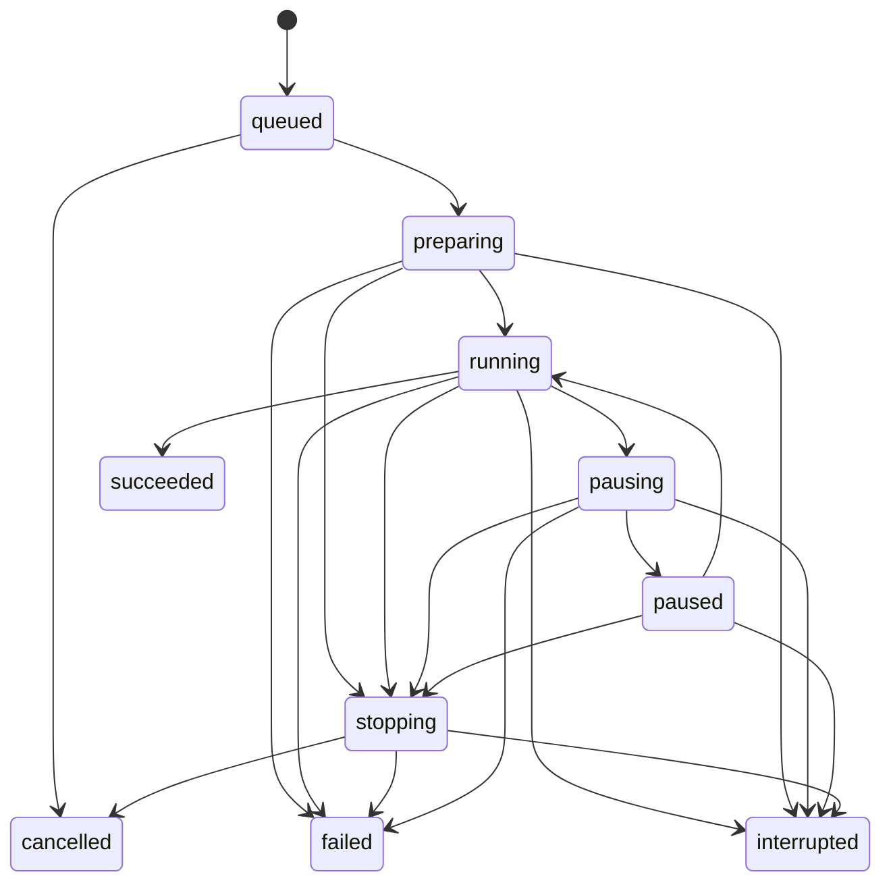

# 运行与桌面控制

## 启动事务

创建运行时，Engine 校验流程和目标槽，封存版本、依赖、输入和预算，持久化运行接收记录。只有原生 Agent 取得有效桌面租约后，才允许出现桌面输入。

每个 Engine 默认最多一个活动根运行、16 个排队运行。跨 Engine 的桌面租约由 Agent 按明确队列授予；直接 MCP 输入默认遇忙即拒绝，不延迟到未来突然执行。只读采集和图像作业不占根输入租约，但有各自并发限制。

## 状态机

succeeded 要求主流程成功、全部子任务已收拢、子调用错误已由显式错误路径处理，且输入清理成功。同步调用或 join 的失败经过父流程 on.error 成功处理后，允许整次运行成功；未处理的后台失败使所属调用失败。failed 记录节点错误与清理结果；cancelled 要求停止和释放已确认。进程中断后的活动运行标为 interrupted，不自动继续到下一个节点。

## 租约与输入段

租约绑定 workspace、run、Engine 实例、Agent epoch、代次、授权目标和到期条件。Agent 在每个输入段派发前重做检查；名称、PID 或管道地址不单独构成许可。

一个根运行取得桌面预约后，任务树内仍按调用身份串行取得输入段。按键或鼠标持续按下期间维持归属；点击、拖拽、组合键与轨迹不能被其他调用穿插。暂停释放实际按下状态，默认保留该运行的桌面预约；切换运行需先停止或明确让出预约。释放与恢复持有输入分别构成真实的原生事件，拖拽等连续手势可能已被目标应用结束，不能把暂停描述为目标应用完全没有收到变化。

心跳初始间隔 200ms，租约失联阈值 2s，按单调时钟计算。系统休眠与桌面切换直接触发停止发送，不等心跳超时。阈值通过高负载测试调整，调整后须通过失联停止发送与输入释放测试。

## 输入结果与核对

Engine 在持久操作账中登记输入段，再向 Agent 提交同一 segmentId 和参数摘要。Agent 记录接收及完成收据，同 ID 同参数返回既有状态，同 ID 不同参数拒绝。

轨迹以整段为耐久操作单位，逐事件只维护内存台账，避免磁盘写入扰乱时间轴。Agent 崩溃后不能从最后一条日志推测已播放的精确事件位置；整段效果保持 uncertain，恢复时要求重新检查目标。

各平台后端完成本段规定的原生提交后状态为 sent。Windows 核对 SendInput 的接受计数；macOS 使用事件投递调用边界；X11 和 EI 核对连接错误与协议提交边界。没有逐事件接收回执的后端按其可确认的调用或协议边界推进游标；提交过程或位置不明确时进入 uncertain。流程配置了后置匹配或断言并成功时，相关效果可记为 verified。任务执行器不能由输入接口返回成功推定目标应用已经完成提交。

## 连续运动与时序超限

轨迹资源整段准入，原生输入逐事件发送；完整事件、按钮生命周期与时间间隔共同决定绘制结果。Windows 发送端使用阻止鼠标移动消息合并的系统标志，其他后端按各自原生队列及时提交；不能将不同期限的整条轨迹一次注入，也不能把录制轨迹改写成首尾拖拽。

初始时序预算为单次迟到 20ms、累计后缀顺延不超过 max(50ms, 原始段时长的 2%)；超限以 INPUT_TIMING_OVERRUN 进入正常暂停和释放，保留精确下一事件游标。未发送后缀只允许按预算整体顺延，不能丢点或瞬时追发；原 atUs 保持不变。累计顺延与在途段实时状态一同冻结，remainingDelayUs 取顺延后的下一期限；同 Agent 继续沿用该状态。lease.status.reason 返回 INPUT_TIMING_OVERRUN，Engine 查询同一 pauseSnapshot 后更新运行暂停原因。原生接口、生成运动和目标画布验收见[连续指针与笔画](pointer-motion.md)。

## 暂停、停止和急停

| 操作 | Agent | Engine |
|---|---|---|
| 暂停 | 停止后续事件，释放已登记输入 | 冻结主动时钟与子调用，在安全点进入 paused |
| 继续 | 重新检查目标、焦点、显示拓扑和授权 | 按暂停快照恢复；需要恢复的持有输入单独确认 |
| 停止 | 拒绝本运行新段并释放输入 | 取消、收拢子调用与作业后进入终态 |
| 急停 | 独立控制路径撤销所有租约、清队列、释放并锁定 | 将相关运行停止，保留已发生或未确认的效果 |

Agent 的控制线程、回放调度和采集队列分离。急停不进入普通输入队列，也不依赖 React、Engine 或模型请求响应。程序自身注入的热键不触发开始、继续或录制命令。启动输入前要求原生急停热键已成功注册；首次注册失败时给出更换入口并阻止回放。

急停后只有可信本地确认产生的 rearm 能解除锁定。解除锁定不恢复旧租约、不继续旧运行，仍需重新检查目标并明确启动或继续。

释放仅针对本程序台账中的按键与按钮。检测到物理用户输入时默认暂停；与物理按键状态冲突时进入人工接管，不主动抢回焦点或恢复程序按下状态。

## 权限与会话变化

Agent 默认普通权限。目标需要更高完整性时，先停止发送并释放，再通过用户 UAC 操作切换受限 Agent。普通与提升实例共用同一互斥身份，切换没有双发射窗口。

窗口目标在每段前校验前台身份，执行中监听焦点变化；全桌面目标允许在授权显示区域间切换前台窗口。目标消失、句柄复用、锁屏、RDP 断连或拓扑变化时暂停并释放输入。安全桌面不接受自动化操作。全桌面轨迹的来源与映射见[全显示屏录制](recording.md)。

## 失联和恢复

Engine 失联时 Agent 撤销其租约并释放；UI 失联时交互运行默认暂停，只有已明确选择后台模式的运行继续。Agent 自身退出后，Engine 先核对实际进程、最近收据与台账，完成释放核对前不得取得新租约。轨迹中途崩溃不能确定实际按下集合时，保留 uncertain 并进入人工接管；重新绑定与本地确认后才允许新运行，不能仅因新进程启动就标记已释放。

进程恢复只恢复编辑数据、记录和诊断；同一个存活 Agent 内的正常暂停与继续使用下面的实时检查点。外部效果 uncertain 时提供“查看目标”“重新绑定”“新建重试运行”，不自动重发。纯读取可以按有限预算重试。

## 调试和预算

断点位于节点执行前，全调用树暂停；单步执行选定调用的一个节点，其余调用保持暂停。观察变量只读，结果绑定 run 和 frame。断点配置和运行时快照遵循下文的固定版本规则。

运行预算默认 10 分钟主动时间、10,000 次节点执行、8 层调用、8 个后台调用、100,000 个输入事件。父子调用使用较小的剩余预算。暂停不计主动时间，但暂停保留上限默认 30 分钟；到期释放预约并取消运行。修改预算影响新运行。

## 输入细节与接管选择

pointer.click 的 pressDurationMs 控制每次按下到释放的主动等待，默认 50ms，范围 0～10,000ms；intervalMs 表示本次释放到下一次按下的间隔。定位、按下、等待与释放处于同一输入段，取消与异常始终进入释放。

keyboard.chord 支持 1～8 个互不重复的已登记按键，按数组顺序按下、等待 pressDurationMs，再逆序释放。单键也使用同一规则。多个调用不能在其中插入输入；部分按下失败时只释放实际登记的按键。

interruptPolicy 的 pause 默认在物理用户输入后暂停；ignore 只关闭普通物理操作触发的暂停。目标失焦、按住状态与物理输入冲突、锁屏、权限变化、停止和急停始终生效。策略固定到新运行的租约，执行中不静默切换。

run.prepare 和 run.start 的入口与初始值规则见[流程设计](workflow.md)。循环控制信号处理前完成本轮清理；运行共享变量提交与控制事件在同一事务登记，进程恢复后不从旧节点重做已提交写入。

keyboard.down、keyboard.up 和 pointer.button 的显式按下/释放可跨同一运行的多个节点，按下节点的正常完成不自动发送释放；暂停、停止、异常与运行收尾按租约台账释放。直接 input.submit 的临时运行仍在请求收尾清理，不跨独立请求保持输入。

## 正常暂停检查点

`lease.pause` 先将租约置为 pausing，阻止新段准入，在当前原生事件的确认边界停下。Agent 冻结输入段的下一条未发送事件 `nextEventIndex`、已消耗主动时间 `activeElapsedUs`、当前等待剩余值 `remainingDelayUs`，并取得释放前的按住集合、指针物理坐标、目标与拓扑版本。同一暂停请求重试或暂停过程中再次暂停只返回现有转换状态，不创建新游标。随后只释放台账确认由本程序按下的输入；清理成功或本来无须清理时才返回 paused 与 `pauseSnapshot`。

输入操作先展开为有限、有序的原生事件单元，游标范围为 0 到 `eventCount`，等于末尾时表示本段原始事件均已发送。点击的移动、按下与释放分别是事件单元，等待单独计算；Unicode 文本以一个 Unicode 标量对应的完整原生输入批次作为最小边界，不能在代理项之间暂停。操作系统部分接受一个批次且不能精确判定完成位置时，标记 uncertain 并进入清理，不把游标前移或重发猜测的未完成部分。

`cursor=null` 表示停在节点或输入段之间，没有在途原生事件。`heldInputs` 保存释放前的集合，其顺序按类型、键名或按钮名固定，用于继续运行时恢复按住状态。`targets` 按目标令牌固定排序。`inputTargetToken` 来自 Agent 租约中最后一次已确认原生输入的实际目标，有在途段时取该段目标；它独立于段游标保存，因此 keyboard.down 或 pointer.button.down 完成后、下一个节点前暂停仍保留唯一目标。尚未发送任何输入且无在途段时可为空；非空必须在 targets 中，不能用当前前台或集合第一项猜测。`heldInputsHash` 与 `targetStateHash` 分别为两数组的 RFC 8785 UTF-8 编码 SHA-256；`checkpointHash` 覆盖 pauseId、leaseId、agentEpoch、generation、cursor、heldInputsHash、pointer、targetStateHash、inputTargetToken。原生检查点只在当前 Agent 的内存中有效，持久化摘要用于核对和诊断，不能重建可继续游标。

暂停期限默认 30 分钟，由原生单调时钟执行；展示用 `expiresAt` 不改变实际时限。取消、停止、租约撤销、Agent epoch 改变或检查点丢失立即使其失效。Agent 返回 uncertain、清理失败或仍在 pausing 时，Engine 不得显示“可继续”。`lease.status` 核对当前拥有者的实时状态；检查点内的租约、代次和 epoch 必须与外层一致。

## 继续确认事务

`run.snapshot.resume` 提供公开摘要：非暂停、可直接继续、需要本地确认或不可继续。没有持有输入和指针恢复时，现有 `run.resume {runId, expectedControlVersion}` 可由已授权的本地、CLI 或 MCP 调用；Engine 仍须向同一 Agent 核对实时检查点、目标、焦点、权限、拓扑和物理输入冲突，不能绕过核对。

需要恢复按键、按钮，或相对位移需要回到暂停坐标时，外部继续返回 `LOCAL_CONFIRMATION_REQUIRED` 和该运行的本地继续入口。本地调用 `run.resume.prepare` 生成计划，展示需要重新按下的输入、将恢复的指针位置、目标和过期时间。计划最多有效 60 秒，且不超过暂停、目标或租约剩余时限。可信 Host 的确认交互产生不透明的一次性 `confirmationGrant`，绑定 run、pause、epoch、generation、目标与拓扑摘要、检查点、按住集合、指针目的地和 planHash；确认能力同时绑定已认证 Host 连接；服务端按真实来源核对，不能由参数声明调用方。WebView、CLI 或 MCP 不能自行构造；即使外部请求携带同格式确认值，仍返回 LOCAL_CONFIRMATION_REQUIRED，须由本地 Host 完成该计划。

planHash 对 runId、controlVersion、pauseId、agentEpoch、generation、checkpointHash、heldInputs、pointerToRestore、restoreTargetToken、expiresAt 的 RFC 8785 UTF-8 编码计算 SHA-256；checkpointHash 来自 Agent 的实时检查点。无需显式本地计划的直接继续由 Engine 生成同样的内部计划摘要，不生成本地确认能力。

确认界面自身会改变指针位置，Agent 检查计划中的 `pointerToRestore` 是否仍有效，并在确认后受控恢复指针；不要求点击确认期间指针始终停在暂停坐标。确认期间前台可以处于 Studio；计划的 `restoreTargetToken` 固定到暂停检查点的 inputTargetToken，纳入 planHash 和确认能力。恢复输入或指针时该字段必须非空；即使 cursor=null 且拥有多个授权目标，也只能恢复此目标。仅恢复焦点的本地计划同样需要确认；普通外部继续不携带恢复目标，实际前台必须已满足输入目标要求。确认后的受控继续先把焦点切回该授权目标，核对真实前台，再恢复指针和输入；无法取得焦点时保持 paused，不发送按下事件。存在物理按住冲突、目标身份改变或授权失效时拒绝恢复并保留 paused；计划同时失效，界面重新准备。`run.resume.discard` 只取消计划和确认能力，保留运行暂停。

`run.resume` 携带 resumePlanId 与确认能力后，Engine 使用同一 `resumeAttemptId` 调用 `lease.resume`。Agent 先验证所有绑定，再按计划恢复指针及程序持有输入，记录单独的恢复事件，最后从下一条原始事件与剩余主动等待继续。已发送的源事件不重放，暂停时释放的事件不混入源游标。恢复部分失败时清理已恢复集合；效果不明确或清理失败进入 uncertain，不退回可直接继续状态。

计划在成功使用、取消或过期后不可用于新请求。原请求的重复请求根据 command_receipt 返回同一结果；新 requestId 重用已消耗计划返回 `RESUME_PLAN_CONSUMED`。相同 resumeAttemptId 同参数由 Agent 返回既有收据，参数不同返回冲突；Agent 重启后只能报告已核实收据或 uncertain。停止和急停优先于准备与恢复，恢复提交前再比较 controlVersion，不能在停止后复活运行。

## 断点配置与运行绑定

`debug.breakpoints.read` 按根流程 workflowId、revision 返回配置档。尚无配置时返回稳定的 profileId、version=0 和空数组，更新时间取该正式版本创建时间；首次更新以 expectedVersion=0 提交。`debug.breakpoints.update` 使用完整列表替换和版本比较，完成添加、移除、启停；冲突返回最新版本供重新读取，不能合并覆盖其他窗口的改动。

每项断点固定 workflowId、revision、nodeId 和 enabled；只能引用根版本及其已解析、授权的固定子流程闭包中的真实节点。同一三元组最多出现一次，禁用项仍占该身份。编辑源码创建新正式版本后重新建立配置，不把旧节点名自动视为新版本节点。

启动时 `run.start.debug` 可指定 profileId、profileVersion 与 pauseOnEntry，Engine 在准入事务中固定该配置、闭包和摘要；省略 debug 时不隐式启用编辑器断点。配置档后来更新只影响后续运行，当前运行保持创建时的快照。`run.snapshot.debug` 返回已绑定版本、摘要与最近命中 frame/node/visit，多个相同子流程调用仍按实际 frame 区分。

继续或单步越过刚命中的断点时，只对该 frame、节点和本次 visit 豁免一次；循环下一次访问仍可命中。单步完成后再次暂停，后台调用不能越过全树暂停。禁用、删除配置与正式版本清理不破坏已有运行固定快照。输入段中的正常暂停仍使用实时检查点；在节点前命中且无输入在途时 cursor 为空。

## 平台能力与坐标恢复

运行准备按[平台能力](../architecture/platforms.md)检查每个输入节点、轨迹版本、文本字符、目标激活和急停条件；实际发送前再次检查当前权限与会话代次。Windows 提升、macOS 隐私授权、Wayland Portal 授权分别走其本地控制入口。

暂停位置和恢复位置保留原来的全局物理或 displayId 屏内表达；恢复时使用当前已核对的逐屏变换。不同后端、相对量单位或权限状态不能通过继续计划自动替换。跨平台资源可以打开和编辑，原生执行仍使用当前目标、实际能力和明确的显示映射。

## 纯逻辑执行

固定计划、显式调用帧、协作调度、敏感标签与格式 5 增量存储见[纯逻辑执行内核](../development/execution-core.md)。
