# 全界面原型设计

设计版本：0.1.0  
更新日期：2026-11-07

共 248 个界面，覆盖页面、属性面板、抽屉、弹窗、浮条、选区覆盖层、安装维护及关键异常状态。

[打开可点击原型](../prototypes/index.html) · [原型使用说明](../prototypes/README.md) · [界面数据清单](../prototypes/catalog.json)

## 主要界面

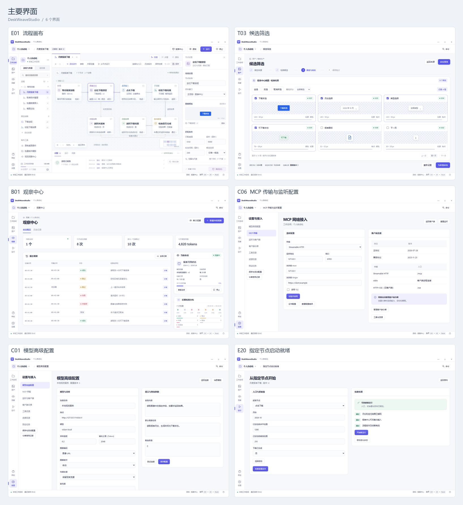

## 画板与交互

常规画板为 1440×900，窄窗口为 800×600。原型沿用工作台的导航、语义配色、可见焦点和三视图文档结构。
画册左侧按任务分组，可搜索界面；右侧列出入口、主操作、画板和需求。图中的按钮可在原型中跳转，表单选择在当前页面预览。

窗口选择器和权限提升由系统负责；相应图展示选择参考布局与应用交接状态。急停解除不恢复旧运行；保存失败另有源码原文与有效结构的副本入口。

中文参数与变量名在表单中作为显示别名，分别保存到 extensions 的 studio.parameter-labels 和 studio.variable-labels；执行键与表达式 AST 保持公共契约格式。

## 核心任务路径

| 任务 | 界面路径 |
|---|---|
| 首次制作 | 首次启动 → 新建工作空间 → 新建流程 → 录制准备 → 时间轴 → 流程画布 |
| 图像定位 | 目标窗口 → 截图选区 → 模板制作 → 匹配测试 → 节点属性 |
| 运行与调试 | 运行准备 → 运行监控 → 暂停过程 → 断点与单步 → 完成或失败详情 |
| 接管与恢复 | 急停锁定 / 输入清理失败 → 本地确认 → 保留已停止记录 → 新运行 |
| 版本与草稿 | 流程版本 → 差异 → 恢复新草稿；保存失败 → 草稿副本 |
| 任务包 | 导出固定版本 → 导入校验 → 同名处理 → 重新绑定目标 |
| 批量模板 | 资产 → 提取条件 → 候选筛选 → 命名预览 → 冲突处理 → 保存批次 → 导出 |
| 持续观察 | 观察中心 → 会话配置 → 运行与停止 → 历史过滤 → 记录详情 → 导出 |
| 高级配置 | 模型参数 → 图像消息编辑与预览；MCP 传输 → TLS → 令牌 → 能力目录 |
| 指定入口 | 缺失值检查 → 初始值 → 启动准备 → 新运行；目标改变后重新检查 |
| 外部集成 | MCP 客户端 → 对象与能力授权 → 客户端活动 → 关联运行 |
| 安装与更新 | 安装选项 → 组件安装 → 更新准备 → 数据检查 → 打开或恢复新目录 |

## 工作空间与开始

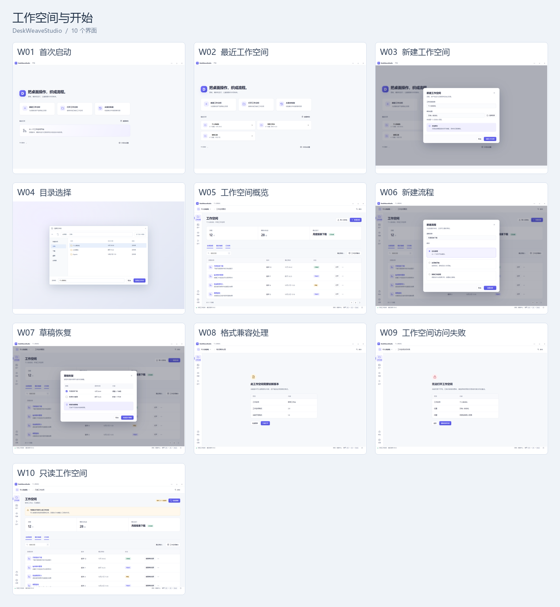

| 编号 | 界面与设计图 | 操作任务 | 主要操作与完成结果 |
|---|---|---|---|
| W01 | [首次启动](../prototypes/images/W01-welcome.png) · [交互](../prototypes/index.html#welcome) | 选择创建、打开或恢复工作空间。 | 新建工作空间：新建工作空间 |
| W02 | [最近工作空间](../prototypes/images/W02-recent.png) · [交互](../prototypes/index.html#recent) | 继续最近制作，或切换独立工作空间。 | 打开工作空间：工作空间概览 |
| W03 | [新建工作空间](../prototypes/images/W03-create-workspace.png) · [交互](../prototypes/index.html#create-workspace) | 填写名称、选择目录并建立工作空间。 | 创建工作空间：工作空间概览 |
| W04 | [目录选择](../prototypes/images/W04-native-folder.png) · [交互](../prototypes/index.html#native-folder) | 选择新建、打开或导出使用的本地目录。 | 选择此文件夹：新建工作空间 |
| W05 | [工作空间概览](../prototypes/images/W05-workspace.png) · [交互](../prototypes/index.html#workspace) | 搜索、排序并打开流程。 | 打开流程：流程画布 |
| W06 | [新建流程](../prototypes/images/W06-new-flow.png) · [交互](../prototypes/index.html#new-flow) | 命名流程并选择空白或已有模板。 | 创建流程：流程画布 |
| W07 | [草稿恢复](../prototypes/images/W07-draft-recovery.png) · [交互](../prototypes/index.html#draft-recovery) | 对照最近保存版本，恢复中断前的编辑。 | 恢复选中草稿：流程画布 |
| W08 | [格式兼容处理](../prototypes/images/W08-format-incompatible.png) · [交互](../prototypes/index.html#format-incompatible) | 保留原数据，选择只读查看或使用支持版本。 | 只读打开：只读工作空间 |
| W09 | [工作空间访问失败](../prototypes/images/W09-workspace-permission.png) · [交互](../prototypes/index.html#workspace-permission) | 确认实际目录和访问权限后重试。 | 重新选择目录：目录选择 |
| W10 | [只读工作空间](../prototypes/images/W10-workspace-readonly.png) · [交互](../prototypes/index.html#workspace-readonly) | 在不支持写入的新格式中查看目录，关闭编辑与运行入口。 | 检查更新：发现更新 |

## 流程制作与版本

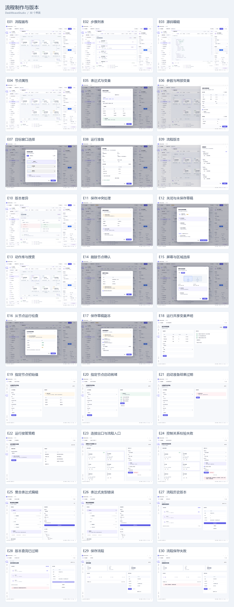

| 编号 | 界面与设计图 | 操作任务 | 主要操作与完成结果 |
|---|---|---|---|
| E01 | [流程画布](../prototypes/images/E01-editor-graph.png) · [交互](../prototypes/index.html#editor-graph) | 用命名出口组织动作，查看节点与目标。 | 运行：运行准备 |
| E02 | [步骤列表](../prototypes/images/E02-editor-steps.png) · [交互](../prototypes/index.html#editor-steps) | 使用键盘和结构列表编辑同一流程。 | 切换到流程：流程画布 |
| E03 | [源码编辑](../prototypes/images/E03-editor-source.png) · [交互](../prototypes/index.html#editor-source) | 查看同一流程的格式、引用与字段诊断。 | 切换到步骤：步骤列表 |
| E04 | [节点属性](../prototypes/images/E04-node-properties.png) · [交互](../prototypes/index.html#node-properties) | 编辑定位节点的目标、模板、阈值和输出。 | 使用表达式：表达式与变量 |
| E05 | [表达式与变量](../prototypes/images/E05-expression.png) · [交互](../prototypes/index.html#expression) | 从可见变量选择数据路径并校验表达式。 | 应用表达式：节点属性 |
| E06 | [参数与局部变量](../prototypes/images/E06-flow-parameters.png) · [交互](../prototypes/index.html#flow-parameters) | 声明输入参数、默认值、类型和敏感属性。 | 保存参数：流程画布 |
| E07 | [目标窗口选择](../prototypes/images/E07-target-select.png) · [交互](../prototypes/index.html#target-select) | 从窗口列表绑定目标，检查名称和采集预览。 | 绑定此窗口：流程画布 |
| E08 | [运行准备](../prototypes/images/E08-run-config.png) · [交互](../prototypes/index.html#run-config) | 确认固定版本、输入、目标和预算后启动。 | 开始运行：运行监控 |
| E09 | [流程版本](../prototypes/images/E09-history.png) · [交互](../prototypes/index.html#history) | 查看不可变版本，比较并恢复为新草稿。 | 比较版本：版本差异 |
| E10 | [版本差异](../prototypes/images/E10-version-diff.png) · [交互](../prototypes/index.html#version-diff) | 按节点和参数比较两个已保存版本。 | 返回版本：流程版本 |
| E11 | [保存冲突处理](../prototypes/images/E11-save-conflict.png) · [交互](../prototypes/index.html#save-conflict) | 比较外部版本与当前草稿，保留有效编辑。 | 另存为分支草稿：流程画布 |
| E12 | [关闭与未保存草稿](../prototypes/images/E12-close-unsaved.png) · [交互](../prototypes/index.html#close-unsaved) | 分别处理草稿保存和活动运行。 | 保存后关闭：工作空间概览 |
| E13 | [动作库与搜索](../prototypes/images/E13-action-library.png) · [交互](../prototypes/index.html#action-library) | 按类别搜索动作，添加到选中节点之后。 | 添加定位动作：节点属性 |
| E14 | [删除节点确认](../prototypes/images/E14-delete-node.png) · [交互](../prototypes/index.html#delete-node) | 检查受影响连线和引用后确认删除。 | 删除节点：流程画布 |
| E15 | [屏幕与区域选择](../prototypes/images/E15-target-display.png) · [交互](../prototypes/index.html#target-display) | 选择显示器或区域，确认显示缩放。 | 选择区域：截图区域覆盖层 |
| E16 | [从节点运行检查](../prototypes/images/E16-run-from-node.png) · [交互](../prototypes/index.html#run-from-node) | 检查指定入口的缺失值，进入初始值准备。 | 填写前置值：指定节点初始值 |
| E17 | [保存草稿副本](../prototypes/images/E17-draft-export.png) · [交互](../prototypes/index.html#draft-export) | 保存失败时保留源码原文和最后有效结构。 | 保存草稿副本：流程画布 |
| E18 | [运行共享变量声明](../prototypes/images/E18-run-shared-declarations.png) · [交互](../prototypes/index.html#run-shared-declarations) | 声明共享值、初始值与本次运行的作用范围。 | 保存声明：流程画布 |
| E19 | [指定节点初始值](../prototypes/images/E19-run-start-values.png) · [交互](../prototypes/index.html#run-start-values) | 填写跳过步骤所需的初始值并重新检查。 | 检查前置条件：校验通过 → 指定节点启动就绪 |
| E20 | [指定节点启动就绪](../prototypes/images/E20-run-start-ready.png) · [交互](../prototypes/index.html#run-start-ready) | 核对已固定的入口、版本、目标与初始值。 | 开始新运行：运行监控 |
| E21 | [启动准备结果过期](../prototypes/images/E21-run-start-stale.png) · [交互](../prototypes/index.html#run-start-stale) | 目标变化后重新生成准备结果。 | 重新检查：指定节点初始值 |
| E22 | [运行接管策略](../prototypes/images/E22-run-interrupt-policy.png) · [交互](../prototypes/index.html#run-interrupt-policy) | 选择物理操作的暂停策略并查看强制中断条件。 | 应用到新运行：运行准备 |
| E23 | [连接出口与流程入口](../prototypes/images/E23-topology-edit.png) · [交互](../prototypes/index.html#topology-edit) | 选择命名出口与目标，确认替换、断开和入口变更；步骤重排仅改变布局。 | 应用控制关系：流程定义的入口与出口经校验后原子应用。 |
| E24 | [控制关系校验失败](../prototypes/images/E24-topology-invalid.png) · [交互](../prototypes/index.html#topology-invalid) | 保留候选连接并定位图环，修正后重新应用。 | 重新应用控制关系：无效连接保持未应用，修正后更新同一草稿。 |
| E25 | [复合表达式编辑](../prototypes/images/E25-expression-builder.png) · [交互](../prototypes/index.html#expression-builder) | 通过结构树或 JSON 编辑嵌套运算，使用合成数据校验后应用。 | 应用到条件：有效 Value AST 写回条件字段。 |
| E26 | [表达式类型错误](../prototypes/images/E26-expression-invalid.png) · [交互](../prototypes/index.html#expression-invalid) | 保留非法编辑与最后有效 AST，定位操作数类型错误。 | 校验并预览：修正后的表达式结果及字段类型可核对。 |
| E27 | [流程历史版本](../prototypes/images/E27-revision-browser.png) · [交互](../prototypes/index.html#revision-browser) | 分页发现固定版本，选择历史版本且保留当前草稿。 | 重新查询：分页发现固定版本，选择历史版本且保留当前草稿。 |
| E28 | [版本查询已过期](../prototypes/images/E28-revision-query-expired.png) · [交互](../prototypes/index.html#revision-query-expired) | 重新建立历史查询，保留所选版本。 | 重新查询：重新建立历史查询，保留所选版本。 |
| E29 | [保存流程](../prototypes/images/E29-content-save.png) · [交互](../prototypes/index.html#content-save) | 保存当前草稿，查看进度并在需要时取消。 | 保存流程：保存完成后显示流程版本。 |
| E30 | [流程保存失败](../prototypes/images/E30-content-transfer-failed.png) · [交互](../prototypes/index.html#content-transfer-failed) | 查看保存失败原因，保留当前草稿并重试。 | 重新保存：重新保存当前草稿。 |

## 动作属性与专用输入

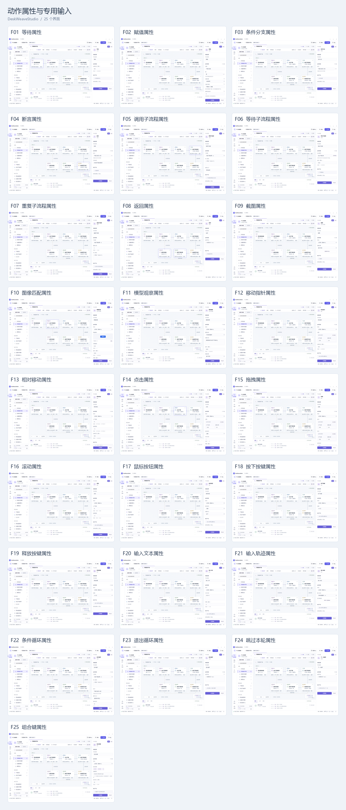

| 编号 | 界面与设计图 | 操作任务 | 主要操作与完成结果 |
|---|---|---|---|
| F01 | [等待属性](../prototypes/images/F01-action-time-wait.png) · [交互](../prototypes/index.html#action-time-wait) | 配置“等待”的全部参数与产出。 | 应用配置：流程画布 |
| F02 | [赋值属性](../prototypes/images/F02-action-data-assign.png) · [交互](../prototypes/index.html#action-data-assign) | 配置“赋值”的全部参数与产出。 | 应用配置：流程画布 |
| F03 | [条件分支属性](../prototypes/images/F03-action-logic-branch.png) · [交互](../prototypes/index.html#action-logic-branch) | 配置“条件分支”的全部参数与产出。 | 应用配置：流程画布 |
| F04 | [断言属性](../prototypes/images/F04-action-logic-assert.png) · [交互](../prototypes/index.html#action-logic-assert) | 配置“断言”的全部参数与产出。 | 应用配置：流程画布 |
| F05 | [调用子流程属性](../prototypes/images/F05-action-flow-call.png) · [交互](../prototypes/index.html#action-flow-call) | 配置“调用子流程”的全部参数与产出。 | 应用配置：流程画布 |
| F06 | [等待子流程属性](../prototypes/images/F06-action-flow-join.png) · [交互](../prototypes/index.html#action-flow-join) | 配置“等待子流程”的全部参数与产出。 | 应用配置：流程画布 |
| F07 | [重复子流程属性](../prototypes/images/F07-action-flow-repeat.png) · [交互](../prototypes/index.html#action-flow-repeat) | 配置“重复子流程”的全部参数与产出。 | 应用配置：流程画布 |
| F08 | [返回属性](../prototypes/images/F08-action-flow-return.png) · [交互](../prototypes/index.html#action-flow-return) | 配置“返回”的全部参数与产出。 | 应用配置：流程画布 |
| F09 | [截图属性](../prototypes/images/F09-action-screen-capture.png) · [交互](../prototypes/index.html#action-screen-capture) | 配置“截图”的全部参数与产出。 | 应用配置：流程画布 |
| F10 | [图像匹配属性](../prototypes/images/F10-action-vision-match.png) · [交互](../prototypes/index.html#action-vision-match) | 配置“图像匹配”的全部参数与产出。 | 应用配置：流程画布 |
| F11 | [模型观察属性](../prototypes/images/F11-action-vision-observe.png) · [交互](../prototypes/index.html#action-vision-observe) | 配置“模型观察”的全部参数与产出。 | 应用配置：流程画布 |
| F12 | [移动指针属性](../prototypes/images/F12-action-pointer-move.png) · [交互](../prototypes/index.html#action-pointer-move) | 配置“移动指针”的全部参数与产出。 | 应用配置：流程画布 |
| F13 | [相对移动属性](../prototypes/images/F13-action-pointer-delta.png) · [交互](../prototypes/index.html#action-pointer-delta) | 配置“相对移动”的全部参数与产出。 | 应用配置：流程画布 |
| F14 | [点击属性](../prototypes/images/F14-action-pointer-click.png) · [交互](../prototypes/index.html#action-pointer-click) | 配置“点击”的全部参数与产出。 | 应用配置：流程画布 |
| F15 | [拖拽属性](../prototypes/images/F15-action-pointer-drag.png) · [交互](../prototypes/index.html#action-pointer-drag) | 配置“拖拽”的全部参数与产出。 | 应用配置：流程画布 |
| F16 | [滚动属性](../prototypes/images/F16-action-pointer-scroll.png) · [交互](../prototypes/index.html#action-pointer-scroll) | 配置“滚动”的全部参数与产出。 | 应用配置：流程画布 |
| F17 | [鼠标按钮属性](../prototypes/images/F17-action-pointer-button.png) · [交互](../prototypes/index.html#action-pointer-button) | 配置“鼠标按钮”的全部参数与产出。 | 应用配置：流程画布 |
| F18 | [按下按键属性](../prototypes/images/F18-action-keyboard-down.png) · [交互](../prototypes/index.html#action-keyboard-down) | 配置“按下按键”的全部参数与产出。 | 应用配置：流程画布 |
| F19 | [释放按键属性](../prototypes/images/F19-action-keyboard-up.png) · [交互](../prototypes/index.html#action-keyboard-up) | 配置“释放按键”的全部参数与产出。 | 应用配置：流程画布 |
| F20 | [输入文本属性](../prototypes/images/F20-action-keyboard-text.png) · [交互](../prototypes/index.html#action-keyboard-text) | 配置“输入文本”的全部参数与产出。 | 应用配置：流程画布 |
| F21 | [输入轨迹属性](../prototypes/images/F21-action-input-trajectory.png) · [交互](../prototypes/index.html#action-input-trajectory) | 配置“输入轨迹”的全部参数与产出。 | 应用配置：流程画布 |
| F22 | [条件循环属性](../prototypes/images/F22-action-flow-loop.png) · [交互](../prototypes/index.html#action-flow-loop) | 编辑条件循环参数、执行边界与产出。 | 应用配置：流程画布 |
| F23 | [退出循环属性](../prototypes/images/F23-action-flow-break.png) · [交互](../prototypes/index.html#action-flow-break) | 编辑退出循环参数、执行边界与产出。 | 应用配置：流程画布 |
| F24 | [跳过本轮属性](../prototypes/images/F24-action-flow-continue.png) · [交互](../prototypes/index.html#action-flow-continue) | 编辑跳过本轮参数、执行边界与产出。 | 应用配置：流程画布 |
| F25 | [组合键属性](../prototypes/images/F25-action-keyboard-chord.png) · [交互](../prototypes/index.html#action-keyboard-chord) | 编辑组合键参数、执行边界与产出。 | 应用配置：流程画布 |

## 录制、截图与定位

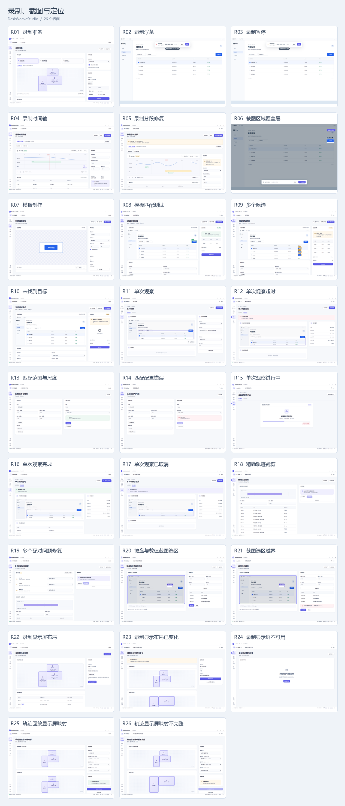

| 编号 | 界面与设计图 | 操作任务 | 主要操作与完成结果 |
|---|---|---|---|
| R01 | [录制准备](../prototypes/images/R01-record-config.png) · [交互](../prototypes/index.html#record-config) | 选择全部显示屏、单屏或窗口，核对物理布局并开始连续录制。 | 开始录制：录制浮条 |
| R02 | [录制浮条](../prototypes/images/R02-record-active.png) · [交互](../prototypes/index.html#record-active) | 查看时长与事件数，暂停或结束录制。 | 暂停：录制暂停 |
| R03 | [录制暂停](../prototypes/images/R03-record-paused.png) · [交互](../prototypes/index.html#record-paused) | 保持目标信息，选择继续或结束。 | 继续录制：录制浮条 |
| R04 | [录制时间轴](../prototypes/images/R04-trajectory-editor.png) · [交互](../prototypes/index.html#trajectory-editor) | 裁剪与查看完整事件，调整按键区间。 | 保存轨迹：流程画布 |
| R05 | [录制分段修复](../prototypes/images/R05-trajectory-repair.png) · [交互](../prototypes/index.html#trajectory-repair) | 核对中断分段与按下配对，保存可修复草稿。 | 应用配对调整：录制时间轴 |
| R06 | [截图区域覆盖层](../prototypes/images/R06-capture-overlay.png) · [交互](../prototypes/index.html#capture-overlay) | 框选目标图像中的区域并确认尺寸。 | 完成选区：模板制作 |
| R07 | [模板制作](../prototypes/images/R07-template-editor.png) · [交互](../prototypes/index.html#template-editor) | 查看来源图像、裁剪边界与模板名称。 | 保存模板：图像资产详情 |
| R08 | [模板匹配测试](../prototypes/images/R08-match-test.png) · [交互](../prototypes/index.html#match-test) | 查看候选、算法分数、尺度与定位结果。 | 使用此定位：节点属性 |
| R09 | [多个候选](../prototypes/images/R09-match-ambiguous.png) · [交互](../prototypes/index.html#match-ambiguous) | 比较候选位置，调整选择策略或模板。 | 调整模板：模板制作 |
| R10 | [未找到目标](../prototypes/images/R10-match-none.png) · [交互](../prototypes/index.html#match-none) | 定位具体条件，调整区域或重新采集。 | 重新采集：截图区域覆盖层 |
| R11 | [单次观察](../prototypes/images/R11-observation.png) · [交互](../prototypes/index.html#observation) | 明确目标区域、连接和输出格式后观察。 | 开始观察：单次观察进行中 |
| R12 | [单次观察超时](../prototypes/images/R12-observation-error.png) · [交互](../prototypes/index.html#observation-error) | 查看独立单次请求的超时结果，重新发起或返回观察中心。 | 重新观察：单次观察 |
| R13 | [匹配范围与尺度](../prototypes/images/R13-match-config.png) · [交互](../prototypes/index.html#match-config) | 配置目标内矩形和模板尺度并测试。 | 测试匹配：校验通过 → 模板匹配测试 |
| R14 | [匹配配置错误](../prototypes/images/R14-match-config-error.png) · [交互](../prototypes/index.html#match-config-error) | 定位重复尺度并保留未应用设置。 | 测试匹配：校验通过 → 模板匹配测试 |
| R15 | [单次观察进行中](../prototypes/images/R15-observation-running.png) · [交互](../prototypes/index.html#observation-running) | 跟踪一次独立观察请求，可取消本次请求。 | 取消本次观察：单次观察已取消；完成 → 单次观察完成 |
| R16 | [单次观察完成](../prototypes/images/R16-observation-succeeded.png) · [交互](../prototypes/index.html#observation-succeeded) | 查看独立观察结果、实际截图与记录时间，并导出本条记录。 | 导出本条记录：观察记录导出 |
| R17 | [单次观察已取消](../prototypes/images/R17-observation-cancelled.png) · [交互](../prototypes/index.html#observation-cancelled) | 查看独立请求的取消结果，持续观察会话不受影响。 | 重新观察：单次观察 |
| R18 | [精确轨迹裁剪](../prototypes/images/R18-trajectory-trim.png) · [交互](../prototypes/index.html#trajectory-trim) | 选择左闭右开时间范围，核对源时间与归零后的事件时间。 | 生成预览：生成未发送输入的完整轨迹预览。 |
| R19 | [多个配对问题修复](../prototypes/images/R19-trajectory-repair-many.png) · [交互](../prototypes/index.html#trajectory-repair-many) | 逐项或批量选择补配对或移除区间，预览后一次应用并可撤销。 | 应用裁剪：全部问题解决后写入一份合法 Trajectory。 |
| R20 | [键盘与数值截图选区](../prototypes/images/R20-capture-keyboard.png) · [交互](../prototypes/index.html#capture-keyboard) | 使用方向键、尺寸快捷键或数值表单调整同一个目标帧矩形。 | 确认选区：输出当前帧内 targetPixels 矩形。 |
| R21 | [截图选区越界](../prototypes/images/R21-capture-boundary.png) · [交互](../prototypes/index.html#capture-boundary) | 保留错误数值和最后有效矩形，修正边界后确认。 | 更新选区：合法整数矩形更新预览。 |
| R22 | [录制显示屏布局](../prototypes/images/R22-record-displays.png) · [交互](../prototypes/index.html#record-displays) | 查看实际排列、负坐标、方向与混合缩放并选择录制范围。 | 使用当前范围：录制准备 |
| R23 | [录制显示布局已变化](../prototypes/images/R23-record-topology-changed.png) · [交互](../prototypes/index.html#record-topology-changed) | 显示器断开后结束旧录制，保存分段或按当前屏幕新建录制。 | 保存已录分段：录制时间轴 |
| R24 | [录制显示屏不可用](../prototypes/images/R24-record-unavailable.png) · [交互](../prototypes/index.html#record-unavailable) | 刷新不可用的显示列表，恢复后选择录制范围。 | 刷新显示屏：录制准备 |
| R25 | [轨迹回放显示屏映射](../prototypes/images/R25-trajectory-displays.png) · [交互](../prototypes/index.html#trajectory-displays) | 核对来源与当前屏幕，使用原布局或逐屏平移映射。 | 应用显示屏映射：完整有效的显示屏映射写入轨迹动作。 |
| R26 | [轨迹显示屏映射不完整](../prototypes/images/R26-trajectory-displays-invalid.png) · [交互](../prototypes/index.html#trajectory-displays-invalid) | 补齐缺失屏幕映射；未匹配或越界时禁止应用。 | 应用显示屏映射：完整有效的显示屏映射写入轨迹动作。 |

## 模板生产与批次

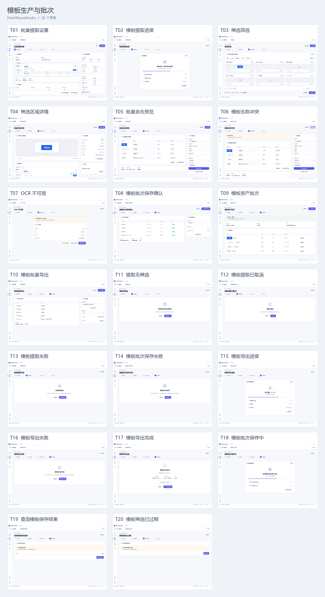

| 编号 | 界面与设计图 | 操作任务 | 主要操作与完成结果 |
|---|---|---|---|
| T01 | [批量提取设置](../prototypes/images/T01-templates-source.png) · [交互](../prototypes/index.html#templates-source) | 选择固定图像来源与范围，设置候选检测、去重和容量。 | 开始提取：模板提取进度 |
| T02 | [模板提取进度](../prototypes/images/T02-templates-progress.png) · [交互](../prototypes/index.html#templates-progress) | 查看检测和融合阶段，取消作业后保留来源设置。 | 取消提取：模板提取已取消；完成 → 候选筛选 |
| T03 | [候选筛选](../prototypes/images/T03-templates-candidates.png) · [交互](../prototypes/index.html#templates-candidates) | 按评分筛选和选择候选，查看尺寸、来源与评分。 | 为所选命名：校验通过 → 批量命名预览 |
| T04 | [候选区域详情](../prototypes/images/T04-templates-candidate.png) · [交互](../prototypes/index.html#templates-candidate) | 检查固定裁剪边界与原始像素，返回来源调整范围。 | 保留此候选：候选筛选 |
| T05 | [批量命名预览](../prototypes/images/T05-templates-naming.png) · [交互](../prototypes/index.html#templates-naming) | 配置 OCR 或规则命名，逐项查看实际来源并覆盖名称。 | 确认名称：校验通过 → 模板批次保存确认 |
| T06 | [模板名称冲突](../prototypes/images/T06-templates-conflict.png) · [交互](../prototypes/index.html#templates-conflict) | 核对已占用名称，追加后缀或手工修改后重新预览。 | 重新生成预览：校验通过 → 批量命名预览 |
| T07 | [OCR 不可用](../prototypes/images/T07-templates-ocr.png) · [交互](../prototypes/index.html#templates-ocr) | 确认缺少的语言包，选择规则命名或结束命名。 | 使用规则命名：批量命名预览 |
| T08 | [模板批次保存确认](../prototypes/images/T08-templates-review.png) · [交互](../prototypes/index.html#templates-review) | 核对选集、命名来源和完整批次后保存。 | 保存整个批次：校验通过 → 模板批次保存中 |
| T09 | [模板资产批次](../prototypes/images/T09-templates-batch.png) · [交互](../prototypes/index.html#templates-batch) | 查看已提交资产与清单，进入批量导出。 | 导出批次：模板批量导出 |
| T10 | [模板批量导出](../prototypes/images/T10-templates-export.png) · [交互](../prototypes/index.html#templates-export) | 选择固定资产版本和输出位置，预览图像与清单。 | 开始导出：模板导出进度 |
| T11 | [提取无候选](../prototypes/images/T11-templates-empty.png) · [交互](../prototypes/index.html#templates-empty) | 区分有效空结果与检测错误，调整筛选条件后重试。 | 调整提取条件：批量提取设置 |
| T12 | [模板提取已取消](../prototypes/images/T12-templates-cancelled.png) · [交互](../prototypes/index.html#templates-cancelled) | 查看取消结果，复用保留的来源与参数重新提取。 | 重新设置：批量提取设置 |
| T13 | [模板提取失败](../prototypes/images/T13-templates-error.png) · [交互](../prototypes/index.html#templates-error) | 查看计算超时原因，调整预算或范围后创建新作业。 | 修改提取设置：批量提取设置 |
| T14 | [模板批次保存失败](../prototypes/images/T14-templates-save-error.png) · [交互](../prototypes/index.html#templates-save-error) | 保留有效候选和命名预览，释放存储后重试提交。 | 检查并重试：模板批次保存确认 |
| T15 | [模板导出进度](../prototypes/images/T15-templates-exporting.png) · [交互](../prototypes/index.html#templates-exporting) | 查看图像和清单写入阶段，取消只影响本次导出。 | 取消导出：模板批量导出；完成 → 模板导出完成 |
| T16 | [模板导出失败](../prototypes/images/T16-templates-export-error.png) · [交互](../prototypes/index.html#templates-export-error) | 查看输出目录写入失败，重新选择位置后导出。 | 更换导出位置：模板批量导出 |
| T17 | [模板导出完成](../prototypes/images/T17-templates-export-succeeded.png) · [交互](../prototypes/index.html#templates-export-succeeded) | 查看已完成的模板图像与清单范围，打开输出位置或返回批次。 | 打开输出位置：显示本次输出位置 |
| T18 | [模板批次保存中](../prototypes/images/T18-templates-saving.png) · [交互](../prototypes/index.html#templates-saving) | 跟踪已接收保存作业，完成登记后显示资产批次。 | 查询保存结果：查询模板保存结果；完成 → 模板资产批次 |
| T19 | [查询模板保存结果](../prototypes/images/T19-templates-receipt-unknown.png) · [交互](../prototypes/index.html#templates-receipt-unknown) | 查询这次保存是否完成，避免重复保存模板。 | 查询保存结果：校验通过 → 模板批次保存中 |
| T20 | [模板候选已过期](../prototypes/images/T20-templates-expired.png) · [交互](../prototypes/index.html#templates-expired) | 保留来源与提取条件，重新提取过期候选。 | 重新提取：批量提取设置 |

## 观察会话与记录

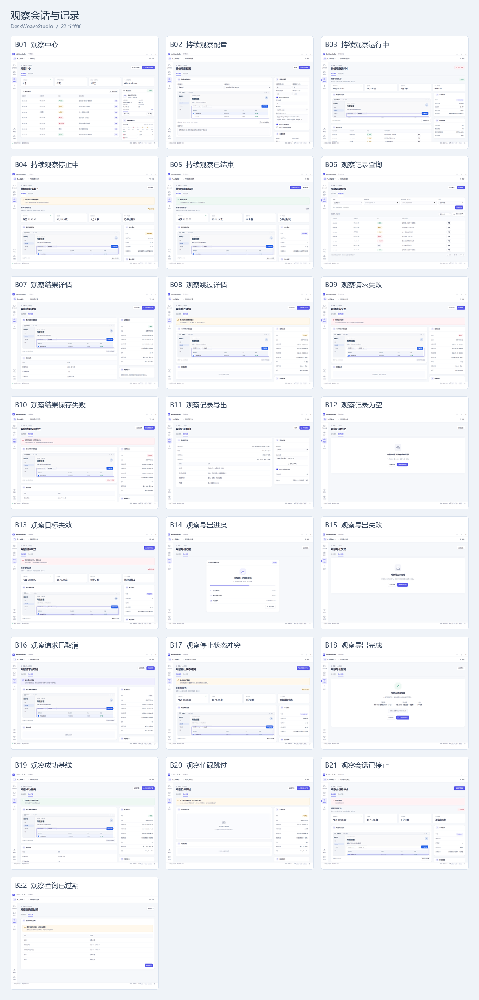

| 编号 | 界面与设计图 | 操作任务 | 主要操作与完成结果 |
|---|---|---|---|
| B01 | [观察中心](../prototypes/images/B01-observations-center.png) · [交互](../prototypes/index.html#observations-center) | 查看当前会话、最近记录和单次观察入口。 | 新建持续观察：持续观察配置 |
| B02 | [持续观察配置](../prototypes/images/B02-observations-config.png) · [交互](../prototypes/index.html#observations-config) | 固定目标、区域、连接、变化检测和记录预算。 | 开始持续观察：持续观察运行中 |
| B03 | [持续观察运行中](../prototypes/images/B03-observations-running.png) · [交互](../prototypes/index.html#observations-running) | 查看当前请求、检查记录和变化检测，按需停止。 | 停止观察：持续观察停止中 |
| B04 | [持续观察停止中](../prototypes/images/B04-observations-stopping.png) · [交互](../prototypes/index.html#observations-stopping) | 停止新触发并等待在途请求取消和收尾。 | 返回概览：观察中心；完成 → 持续观察已结束 |
| B05 | [持续观察已结束](../prototypes/images/B05-observations-stopped.png) · [交互](../prototypes/index.html#observations-stopped) | 查看会话结束原因与记录数量，配置新的观察。 | 查看会话记录：观察记录查询 |
| B06 | [观察记录查询](../prototypes/images/B06-observations-history.png) · [交互](../prototypes/index.html#observations-history) | 按时间、会话与状态筛选，分页查看固定结果集。 | 详情：观察结果详情 |
| B07 | [观察结果详情](../prototypes/images/B07-observations-detail.png) · [交互](../prototypes/index.html#observations-detail) | 查看实际截图、采集与完成时间、配置版本及用量。 | 导出本条记录：观察记录导出 |
| B08 | [观察跳过详情](../prototypes/images/B08-observations-skipped.png) · [交互](../prototypes/index.html#observations-skipped) | 查看区域无显著变化的检查与09:40:30成功基线，区分本次空结果。 | 查看成功基线：观察成功基线 |
| B09 | [观察请求失败](../prototypes/images/B09-observations-failed.png) · [交互](../prototypes/index.html#observations-failed) | 查看请求超时和会话状态，返回配置建立新观察。 | 新建观察：持续观察配置 |
| B10 | [观察结果保存失败](../prototypes/images/B10-observations-save-error.png) · [交互](../prototypes/index.html#observations-save-error) | 查看尚未入库的内存结果并导出独立恢复文件。 | 保存恢复文件：observation-recovery.json |
| B11 | [观察记录导出](../prototypes/images/B11-observations-export.png) · [交互](../prototypes/index.html#observations-export) | 确认固定记录集、输出格式、字段和截图范围。 | 开始导出：观察导出进度 |
| B12 | [观察记录为空](../prototypes/images/B12-observations-empty.png) · [交互](../prototypes/index.html#observations-empty) | 查看当前筛选范围并调整条件或创建观察。 | 新建持续观察：持续观察配置 |
| B13 | [观察目标失效](../prototypes/images/B13-observations-target-error.png) · [交互](../prototypes/index.html#observations-target-error) | 查看目标关闭导致的会话失败，重新绑定后新建。 | 重新选择目标：持续观察配置 |
| B14 | [观察导出进度](../prototypes/images/B14-observations-exporting.png) · [交互](../prototypes/index.html#observations-exporting) | 查看固定记录集与截图写入进度，取消本次导出。 | 取消导出：观察记录查询；完成 → 观察导出完成 |
| B15 | [观察导出失败](../prototypes/images/B15-observations-export-error.png) · [交互](../prototypes/index.html#observations-export-error) | 查看输出位置不可写，选择其他位置后重新导出。 | 更换输出位置：观察记录导出 |
| B16 | [观察请求已取消](../prototypes/images/B16-observations-cancelled.png) · [交互](../prototypes/index.html#observations-cancelled) | 查看本次请求取消结果和实际时间，保留所属持续会话关联。 | 新建观察：持续观察配置 |
| B17 | [观察停止状态冲突](../prototypes/images/B17-observations-control-conflict.png) · [交互](../prototypes/index.html#observations-control-conflict) | 读取最新会话状态，避免重复操作覆盖新的控制结果。 | 读取最新状态：持续观察已结束 |
| B18 | [观察导出完成](../prototypes/images/B18-observations-export-succeeded.png) · [交互](../prototypes/index.html#observations-export-succeeded) | 查看已完成的记录、截图与清单范围，打开输出位置或返回记录。 | 打开输出位置：显示本次输出位置 |
| B19 | [观察成功基线](../prototypes/images/B19-observations-baseline.png) · [交互](../prototypes/index.html#observations-baseline) | 查看09:40:30成功保存的3份可下载报表与实际截图。 | 导出本条记录：观察记录导出 |
| B20 | [观察忙碌跳过](../prototypes/images/B20-observations-busy.png) · [交互](../prototypes/index.html#observations-busy) | 查看上一请求未结束的检查记录，本次不采集图像或追加请求。 | 返回记录：观察记录查询 |
| B21 | [观察会话已停止](../prototypes/images/B21-observations-session-failed.png) · [交互](../prototypes/index.html#observations-session-failed) | 查看凭据或授权失效导致的会话停止，重新配置观察。 | 重新配置观察：持续观察配置 |
| B22 | [观察查询已过期](../prototypes/images/B22-observations-query-expired.png) · [交互](../prototypes/index.html#observations-query-expired) | 保留筛选与排序，重新查询已过期的固定结果集。 | 重新查询：校验通过 → 观察记录查询 |

## 资产与任务包

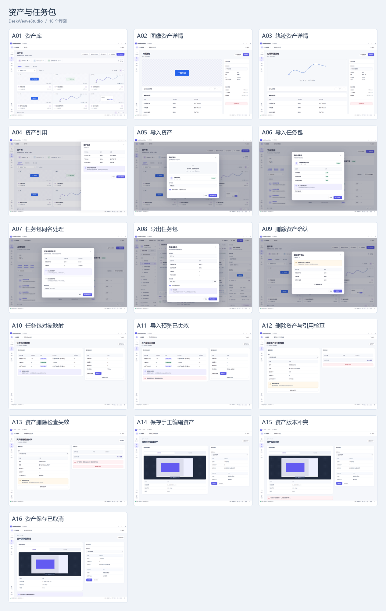

| 编号 | 界面与设计图 | 操作任务 | 主要操作与完成结果 |
|---|---|---|---|
| A01 | [资产库](../prototypes/images/A01-assets.png) · [交互](../prototypes/index.html#assets) | 搜索模板、轨迹和流程资源，查看版本。 | 查看资产：图像资产详情 |
| A02 | [图像资产详情](../prototypes/images/A02-asset-image.png) · [交互](../prototypes/index.html#asset-image) | 查看模板预览、来源、版本与引用。 | 查看引用：资产引用 |
| A03 | [轨迹资产详情](../prototypes/images/A03-asset-trajectory.png) · [交互](../prototypes/index.html#asset-trajectory) | 查看时序、事件种类、持续时间与按键配对。 | 编辑副本：录制时间轴 |
| A04 | [资产引用](../prototypes/images/A04-asset-references.png) · [交互](../prototypes/index.html#asset-references) | 定位依赖该资产版本的流程与运行。 | 打开引用流程：流程画布 |
| A05 | [导入资产](../prototypes/images/A05-asset-import.png) · [交互](../prototypes/index.html#asset-import) | 检查文件类型、名称和导入结果。 | 导入所选文件：资产库 |
| A06 | [导入任务包](../prototypes/images/A06-package-import.png) · [交互](../prototypes/index.html#package-import) | 检查入口流程与依赖完整性后导入。 | 导入任务包：工作空间概览 |
| A07 | [任务包同名处理](../prototypes/images/A07-package-conflict.png) · [交互](../prototypes/index.html#package-conflict) | 对同名不同内容保留新对象，不覆盖历史。 | 作为新流程导入：工作空间概览 |
| A08 | [导出任务包](../prototypes/images/A08-package-export.png) · [交互](../prototypes/index.html#package-export) | 选择固定版本和资源范围，确认保存目录。 | 导出任务包：流程画布 |
| A09 | [删除资产确认](../prototypes/images/A09-asset-delete.png) · [交互](../prototypes/index.html#asset-delete) | 显示仍被引用的版本并阻止误删。 | 保留被引用资产：资产库 |
| A10 | [任务包对象映射](../prototypes/images/A10-package-target-map.png) · [交互](../prototypes/index.html#package-target-map) | 核对独立流程副本、相同内容复用及来源到目标的固定版本映射。 | 确认导入：按有效计划原子导入，并显示真实映射清单。 |
| A11 | [导入预览已失效](../prototypes/images/A11-package-target-invalid.png) · [交互](../prototypes/index.html#package-target-invalid) | 保留文件选择，重新检查导入内容。 | 重新预览映射：取得当前目录下的新映射计划。 |
| A12 | [删除资产与引用检查](../prototypes/images/A12-asset-delete-review.png) · [交互](../prototypes/index.html#asset-delete-review) | 重新读取全部引用总数，确认无依赖后删除整个资产及其版本。 | 删除整个资产：版本和引用检查通过后删除资产。 |
| A13 | [资产删除检查失效](../prototypes/images/A13-asset-delete-stale.png) · [交互](../prototypes/index.html#asset-delete-stale) | 版本或引用变化时保留资产，重新检查可见与不可见引用数量。 | 重新检查引用：读取当前版本与完整引用数量，仍被引用时阻止删除。 |
| A14 | [保存手工编辑资产](../prototypes/images/A14-asset-edit-save.png) · [交互](../prototypes/index.html#asset-edit-save) | 选择保存方式和名称，保存编辑后的图像或轨迹。 | 保存资产：保存完成后显示资产版本。 |
| A15 | [资产版本冲突](../prototypes/images/A15-asset-edit-conflict.png) · [交互](../prototypes/index.html#asset-edit-conflict) | 核对更新后的资产版本，保留编辑内容并重新保存。 | 重新保存：以核对后的版本保存当前编辑。 |
| A16 | [资产保存已取消](../prototypes/images/A16-asset-edit-cancelled.png) · [交互](../prototypes/index.html#asset-edit-cancelled) | 保留当前编辑内容，按需重新保存。 | 保存资产：保存当前编辑内容。 |

## 运行、调试与恢复

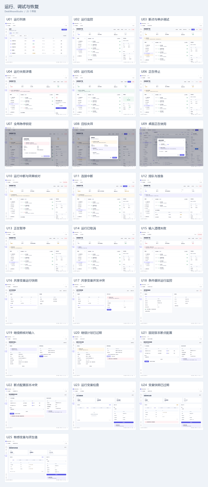

| 编号 | 界面与设计图 | 操作任务 | 主要操作与完成结果 |
|---|---|---|---|
| U01 | [运行列表](../prototypes/images/U01-runs.png) · [交互](../prototypes/index.html#runs) | 按流程、时间和状态查询运行。 | 查看运行：运行监控 |
| U02 | [运行监控](../prototypes/images/U02-run-running.png) · [交互](../prototypes/index.html#run-running) | 查看调用树、当前步骤、时间线与输入结果。 | 暂停：正在暂停 |
| U03 | [断点与单步调试](../prototypes/images/U03-run-paused.png) · [交互](../prototypes/index.html#run-paused) | 在安全点查看变量，单步执行选中调用。 | 继续运行：运行监控 |
| U04 | [运行失败详情](../prototypes/images/U04-run-failed.png) · [交互](../prototypes/index.html#run-failed) | 查看失败动作、具体原因、附件与清理结果。 | 修改流程：流程画布 |
| U05 | [运行完成](../prototypes/images/U05-run-succeeded.png) · [交互](../prototypes/index.html#run-succeeded) | 核对输出、输入结果和后置检查。 | 再次运行：运行准备 |
| U06 | [正在停止](../prototypes/images/U06-run-stopping.png) · [交互](../prototypes/index.html#run-stopping) | 持续展示取消、子调用收拢和释放进度。 | 查看停止结果：运行已取消 |
| U07 | [全局急停锁定](../prototypes/images/U07-emergency.png) · [交互](../prototypes/index.html#emergency) | 核对输入释放后，以本地确认解除锁定。 | 确认接管并解除锁定：工作空间概览 |
| U08 | [目标失效](../prototypes/images/U08-target-lost.png) · [交互](../prototypes/index.html#target-lost) | 保留已执行结果，重新绑定目标后检查继续条件。 | 重新绑定目标：目标窗口选择 |
| U09 | [桌面正在使用](../prototypes/images/U09-desktop-busy.png) · [交互](../prototypes/index.html#desktop-busy) | 查看当前运行，选择等待或返回。 | 查看占用运行：运行监控 |
| U10 | [运行中断与效果核对](../prototypes/images/U10-run-interrupted.png) · [交互](../prototypes/index.html#run-interrupted) | 核对未确认输入，查看目标后创建新的重试。 | 查看并重新绑定：目标窗口选择 |
| U11 | [连接中断](../prototypes/images/U11-run-disconnected.png) · [交互](../prototypes/index.html#run-disconnected) | 保留已有运行视图，重连后恢复服务快照。 | 重新连接：运行监控 |
| U12 | [排队与准备](../prototypes/images/U12-run-queued.png) · [交互](../prototypes/index.html#run-queued) | 展示等待原因与队列位置，允许取消排队。 | 取消排队：运行已取消 |
| U13 | [正在暂停](../prototypes/images/U13-run-pausing.png) · [交互](../prototypes/index.html#run-pausing) | 等待释放输入与调用树安全点，保留停止入口。 | 查看暂停结果：断点与单步调试 |
| U14 | [运行已取消](../prototypes/images/U14-run-cancelled.png) · [交互](../prototypes/index.html#run-cancelled) | 核对停止原因、已发生结果与释放确认。 | 返回编辑：流程画布 |
| U15 | [输入清理失败](../prototypes/images/U15-cleanup-failed.png) · [交互](../prototypes/index.html#cleanup-failed) | 阻止新输入，显示接管和恢复的具体动作。 | 打开接管确认：全局急停锁定 |
| U16 | [共享变量运行快照](../prototypes/images/U16-run-shared-variables.png) · [交互](../prototypes/index.html#run-shared-variables) | 只读查看本次运行共享变量和版本。 | 返回运行：运行监控 |
| U17 | [共享变量并发冲突](../prototypes/images/U17-run-variable-conflict.png) · [交互](../prototypes/index.html#run-variable-conflict) | 查看未应用的冲突写入并重新读取。 | 重新读取变量：共享变量运行快照 |
| U18 | [条件循环运行监控](../prototypes/images/U18-run-loop.png) · [交互](../prototypes/index.html#run-loop) | 查看实际轮次、退出条件和剩余预算。 | 查看循环配置：条件循环属性 |
| U19 | [继续前核对输入](../prototypes/images/U19-resume-review.png) · [交互](../prototypes/index.html#resume-review) | 核对暂停检查点、目标、指针和持有输入，通过本地确认继续。 | 确认并继续：一次性确认消费后从同一检查点继续。 |
| U20 | [继续计划已过期](../prototypes/images/U20-resume-stale.png) · [交互](../prototypes/index.html#resume-stale) | 保留暂停运行，重新检查后生成新的本地确认计划。 | 重新检查：生成绑定当前暂停检查点的新计划。 |
| U21 | [固定版本断点配置](../prototypes/images/U21-breakpoints-edit.png) · [交互](../prototypes/index.html#breakpoints-edit) | 增删并启用断点，整组保存到固定流程版本，仅新运行生效。 | 保存整组断点：保存新断点配置版本，当前运行保持原快照。 |
| U22 | [断点配置版本冲突](../prototypes/images/U22-breakpoints-conflict.png) · [交互](../prototypes/index.html#breakpoints-conflict) | 保留待保存断点，重新读取后检查并提交整组配置。 | 重新读取并保留编辑：更新基准版本，待保存断点继续保留。 |
| U23 | [运行变量检查](../prototypes/images/U23-variables-inspect.png) · [交互](../prototypes/index.html#variables-inspect) | 读取固定调用与范围的变量页，敏感值保持遮蔽。 | 读取快照：读取固定调用与范围的变量页，敏感值保持遮蔽。 |
| U24 | [变量快照已过期](../prototypes/images/U24-variables-expired.png) · [交互](../prototypes/index.html#variables-expired) | 保留调用与范围选择，创建新的变量快照。 | 重新读取：保留调用与范围选择，创建新的变量快照。 |
| U25 | [敏感变量与派生值](../prototypes/images/U25-variables-redacted.png) · [交互](../prototypes/index.html#variables-redacted) | 查看敏感输入及派生值的遮蔽状态。 | 读取快照：查看敏感输入及派生值的遮蔽状态。 |

## 设置与外部接入

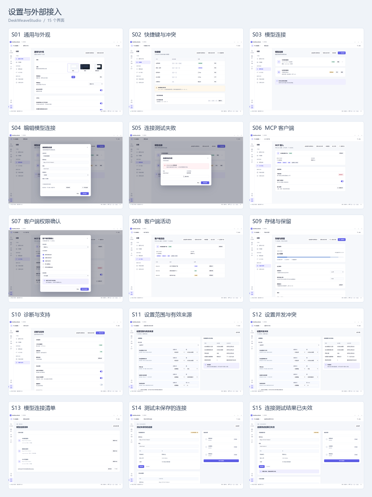

| 编号 | 界面与设计图 | 操作任务 | 主要操作与完成结果 |
|---|---|---|---|
| S01 | [通用与外观](../prototypes/images/S01-settings-general.png) · [交互](../prototypes/index.html#settings-general) | 设置主题、密度、语言和窗口行为。 | 预览暗色主题：暗色工作台 |
| S02 | [快捷键与冲突](../prototypes/images/S02-settings-shortcuts.png) · [交互](../prototypes/index.html#settings-shortcuts) | 配置工作台和系统热键，处理注册冲突。 | 查看快捷键：快捷键帮助 |
| S03 | [模型连接](../prototypes/images/S03-settings-connections.png) · [交互](../prototypes/index.html#settings-connections) | 管理本地和远程观察连接。 | 添加连接：编辑模型连接 |
| S04 | [编辑模型连接](../prototypes/images/S04-connection-edit.png) · [交互](../prototypes/index.html#connection-edit) | 配置端点、模型和密钥模式，测试后保存。 | 保存连接：模型连接 |
| S05 | [连接测试失败](../prototypes/images/S05-connection-failed.png) · [交互](../prototypes/index.html#connection-failed) | 保留原配置，修正地址或密钥后重试。 | 修改连接：编辑模型连接 |
| S06 | [MCP 客户端](../prototypes/images/S06-settings-mcp.png) · [交互](../prototypes/index.html#settings-mcp) | 查看客户端、工作空间范围和已授予能力。 | 管理授权：客户端权限确认 |
| S07 | [客户端权限确认](../prototypes/images/S07-mcp-approval.png) · [交互](../prototypes/index.html#mcp-approval) | 按工作空间、目标与用途授予有限能力。 | 保存所选授权：MCP 客户端 |
| S08 | [客户端活动](../prototypes/images/S08-mcp-activity.png) · [交互](../prototypes/index.html#mcp-activity) | 按客户端查看任务接收、运行和取消结果。 | 查看关联运行：运行监控 |
| S09 | [存储与保留](../prototypes/images/S09-settings-storage.png) · [交互](../prototypes/index.html#settings-storage) | 查看占用、备份和附件保留策略。 | 创建备份：创建工作空间备份 |
| S10 | [诊断与支持](../prototypes/images/S10-settings-diagnostics.png) · [交互](../prototypes/index.html#settings-diagnostics) | 选择支持材料范围并预览导出内容。 | 预览支持包：支持包导出预览 |
| S11 | [设置范围与有效来源](../prototypes/images/S11-settings-overrides.png) · [交互](../prototypes/index.html#settings-overrides) | 编辑用户或工作空间覆盖，按批次保存并区分即时、下次运行与重启生效。 | 整批保存：CAS通过后提交整批set/reset并显示逐项生效时间。 |
| S12 | [设置并发冲突](../prototypes/images/S12-settings-conflict.png) · [交互](../prototypes/index.html#settings-conflict) | 保留本批编辑，重新读取范围与继承版本后核对保存。 | 重新读取并保留编辑：新基准与本批待保存编辑分别保留。 |
| S13 | [模型连接清单](../prototypes/images/S13-connection-browser.png) · [交互](../prototypes/index.html#connection-browser) | 读取连接元数据并打开配置，凭据保持受保护。 | 重新查询：读取连接元数据并打开配置，凭据保持受保护。 |
| S14 | [测试未保存的连接](../prototypes/images/S14-connection-draft-test.png) · [交互](../prototypes/index.html#connection-draft-test) | 测试当前编辑的连接，查看服务和模型是否可用。 | 测试连接：显示当前配置的连接测试结果。 |
| S15 | [连接测试结果已失效](../prototypes/images/S15-connection-test-stale.png) · [交互](../prototypes/index.html#connection-test-stale) | 修改配置使原测试失效，迟到结果不覆盖当前状态。 | 测试当前草稿：修改配置使原测试失效，迟到结果不覆盖当前状态。 |

## 模型高级配置与 MCP 管理

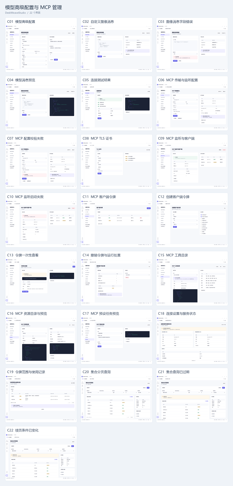

| 编号 | 界面与设计图 | 操作任务 | 主要操作与完成结果 |
|---|---|---|---|
| C01 | [模型高级配置](../prototypes/images/C01-connection-advanced.png) · [交互](../prototypes/index.html#connection-advanced) | 配置采样、预算、图像编码、提示和附加参数。 | 保存配置：校验通过 → 模型连接 |
| C02 | [自定义图像消息](../prototypes/images/C02-connection-template.png) · [交互](../prototypes/index.html#connection-template) | 编辑图像消息片段并检查占位符。 | 校验并预览：校验通过 → 模型消息预览 |
| C03 | [图像消息字段错误](../prototypes/images/C03-connection-template-error.png) · [交互](../prototypes/index.html#connection-template-error) | 保留模板并定位未知占位符错误。 | 校验并预览：校验通过 → 模型消息预览 |
| C04 | [模型消息预览](../prototypes/images/C04-connection-message-preview.png) · [交互](../prototypes/index.html#connection-message-preview) | 使用合成图像查看构造后的 JSON 消息。 | 校验并预览：校验通过 → 模型消息预览 |
| C05 | [连接测试结果](../prototypes/images/C05-connection-tested.png) · [交互](../prototypes/index.html#connection-tested) | 分别查看配置、端点和模型可用性。 | 保存连接：校验通过 → 模型连接 |
| C06 | [MCP 传输与监听配置](../prototypes/images/C06-mcp-transport.png) · [交互](../prototypes/index.html#mcp-transport) | 选择传输、监听地址、端口和来源。 | 校验并启用：校验通过 → MCP 监听与客户端 |
| C07 | [MCP 配置校验失败](../prototypes/images/C07-mcp-transport-error.png) · [交互](../prototypes/index.html#mcp-transport-error) | 处理非回环监听缺少 TLS 的字段错误。 | 修正监听配置：MCP 传输与监听配置 |
| C08 | [MCP TLS 证书](../prototypes/images/C08-mcp-tls.png) · [交互](../prototypes/index.html#mcp-tls) | 选择证书与私钥并检查有效性。 | 应用证书：MCP 传输与监听配置 |
| C09 | [MCP 监听与客户端](../prototypes/images/C09-mcp-listener.png) · [交互](../prototypes/index.html#mcp-listener) | 查看监听入口、支持协议和客户端连接状态。 | 管理令牌：MCP 客户端令牌 |
| C10 | [MCP 监听启动失败](../prototypes/images/C10-mcp-listener-error.png) · [交互](../prototypes/index.html#mcp-listener-error) | 处理端口占用并保留原监听配置。 | 修改端口：MCP 传输与监听配置 |
| C11 | [MCP 客户端令牌](../prototypes/images/C11-mcp-tokens.png) · [交互](../prototypes/index.html#mcp-tokens) | 查看令牌状态、期限和关联目标。 | 创建令牌：创建客户端令牌 |
| C12 | [创建客户端令牌](../prototypes/images/C12-mcp-token-create.png) · [交互](../prototypes/index.html#mcp-token-create) | 选择能力、目标与有效期。 | 创建令牌：校验通过 → 令牌一次性查看 |
| C13 | [令牌一次性查看](../prototypes/images/C13-mcp-token-created.png) · [交互](../prototypes/index.html#mcp-token-created) | 保存本次显示的明文并完成配置。 | 已保存，返回清单：MCP 客户端令牌 |
| C14 | [撤销令牌与运行处置](../prototypes/images/C14-mcp-token-revoke.png) · [交互](../prototypes/index.html#mcp-token-revoke) | 检查受影响会话并选择关联运行的处置。 | 撤销令牌：校验通过 → MCP 客户端令牌 |
| C15 | [MCP 工具目录](../prototypes/images/C15-mcp-tools.png) · [交互](../prototypes/index.html#mcp-tools) | 按能力查看工具组与授权要求。 | 查看预设任务：MCP 预设任务预览 |
| C16 | [MCP 资源目录与预览](../prototypes/images/C16-mcp-resources.png) · [交互](../prototypes/index.html#mcp-resources) | 查看可读对象、媒体类型和分块预览。 | 预览观察记录：观察结果详情 |
| C17 | [MCP 预设任务预览](../prototypes/images/C17-mcp-prompts.png) · [交互](../prototypes/index.html#mcp-prompts) | 填写参数并预览返回消息。 | 预览消息：更新本页预设任务消息预览 |
| C18 | [连接设置与服务状态](../prototypes/images/C18-mcp-config-read.png) · [交互](../prototypes/index.html#mcp-config-read) | 分别读取已保存及实际生效的网络配置和脱敏TLS状态。 | 重新读取服务快照：保存版本、活动版本与需重启状态来自同次读取。 |
| C19 | [令牌范围与使用记录](../prototypes/images/C19-mcp-token-query.png) · [交互](../prototypes/index.html#mcp-token-query) | 按状态筛选并分页读取名称、权限、目标、期限和最近使用记录。 | 下一页：读取同一查询中的后续令牌；清单不包含明文。 |
| C20 | [集合分页查询](../prototypes/images/C20-mcp-query.png) · [交互](../prototypes/index.html#mcp-query) | 设置条件、排序和每页数量，逐页查询授权集合。 | 查询：返回当前条件下的第一页。 |
| C21 | [集合查询已过期](../prototypes/images/C21-mcp-query-expired.png) · [交互](../prototypes/index.html#mcp-query-expired) | 保留条件，重新建立已过期的查询。 | 重新查询：创建新快照并从第一页读取。 |
| C22 | [续页条件已变化](../prototypes/images/C22-mcp-query-error.png) · [交互](../prototypes/index.html#mcp-query-error) | 保留新的排序条件，重新查询后继续。 | 重新查询：新的查询与当前条件一致。 |

## 安装、更新与数据维护

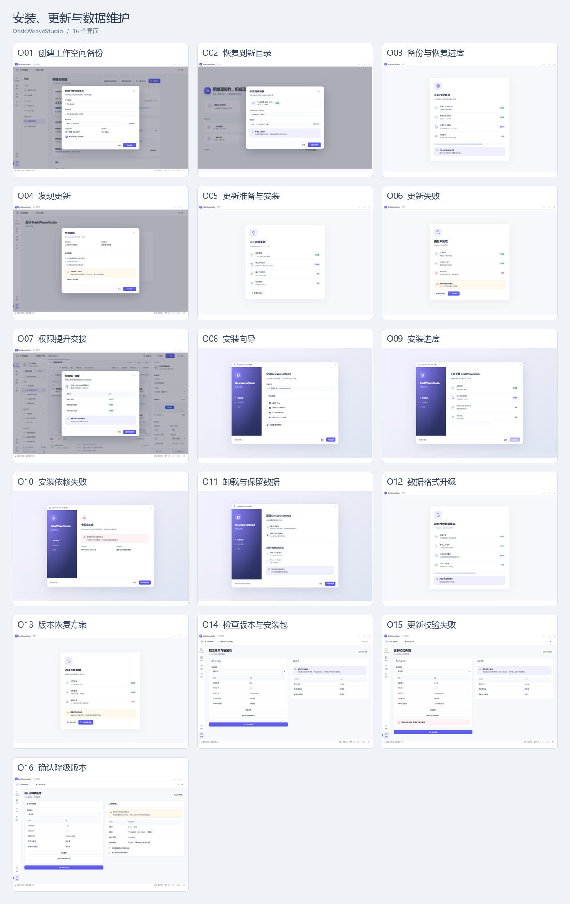

| 编号 | 界面与设计图 | 操作任务 | 主要操作与完成结果 |
|---|---|---|---|
| O01 | [创建工作空间备份](../prototypes/images/O01-backup-create.png) · [交互](../prototypes/index.html#backup-create) | 确认一致备份的目录与包含范围。 | 开始备份：备份与恢复进度 |
| O02 | [恢复到新目录](../prototypes/images/O02-backup-restore.png) · [交互](../prototypes/index.html#backup-restore) | 选择备份与新目录，保留原工作空间。 | 校验并恢复：备份与恢复进度 |
| O03 | [备份与恢复进度](../prototypes/images/O03-backup-progress.png) · [交互](../prototypes/index.html#backup-progress) | 显示工作空间文件的复制、检查和恢复进度。 | 打开恢复的工作空间：工作空间概览 |
| O04 | [发现更新](../prototypes/images/O04-update-available.png) · [交互](../prototypes/index.html#update-available) | 查看版本、更新范围及活动运行影响。 | 准备更新：更新准备与安装 |
| O05 | [更新准备与安装](../prototypes/images/O05-update-preparing.png) · [交互](../prototypes/index.html#update-preparing) | 等待草稿持久化、运行停止、备份与组件切换。 | 检查数据兼容性：数据格式升级 |
| O06 | [更新失败](../prototypes/images/O06-update-failed.png) · [交互](../prototypes/index.html#update-failed) | 保留有效版本并给出具体恢复路径。 | 查看恢复方案：版本恢复方案 |
| O07 | [权限提升交接](../prototypes/images/O07-permissions-elevation.png) · [交互](../prototypes/index.html#permissions-elevation) | 等待 Windows 权限确认，失败后保持文档。 | 返回目标选择：目标窗口选择 |
| O08 | [安装向导](../prototypes/images/O08-installer.png) · [交互](../prototypes/index.html#installer) | 选择每用户目录与离线依赖。 | 开始安装：安装进度 |
| O09 | [安装进度](../prototypes/images/O09-install-progress.png) · [交互](../prototypes/index.html#install-progress) | 查看实际组件安装与入口创建阶段。 | 启动工作台：首次启动 |
| O10 | [安装依赖失败](../prototypes/images/O10-install-failed.png) · [交互](../prototypes/index.html#install-failed) | 明确 WebView2 或存储问题及恢复动作。 | 返回安装选项：安装向导 |
| O11 | [卸载与保留数据](../prototypes/images/O11-uninstall.png) · [交互](../prototypes/index.html#uninstall) | 确认卸载程序，单独处理工作空间数据。 | 确认卸载程序：最近工作空间 |
| O12 | [数据格式升级](../prototypes/images/O12-migration.png) · [交互](../prototypes/index.html#migration) | 显示备份、独占转换与完整性验证。 | 完成并打开：工作空间概览 |
| O13 | [版本恢复方案](../prototypes/images/O13-rollback.png) · [交互](../prototypes/index.html#rollback) | 区分程序回退与数据恢复，保留新增编辑。 | 恢复到新目录：恢复到新目录 |
| O14 | [检查版本与安装包](../prototypes/images/O14-update-trust.png) · [交互](../prototypes/index.html#update-trust) | 选择更新通道，检查适用系统、发布者和安装包完整性。 | 进入安装准备：验证通过后保存草稿、停止运行并检查备份。 |
| O15 | [更新校验失败](../prototypes/images/O15-update-verification-failed.png) · [交互](../prototypes/index.html#update-verification-failed) | 展示具体校验失败，重新选择有效更新包后再次验证。 | 校验更新：失败保持未安装；通过后开放安装准备。 |
| O16 | [确认降级版本](../prototypes/images/O16-update-downgrade.png) · [交互](../prototypes/index.html#update-downgrade) | 确认所选旧版本、工作空间备份及数据兼容性。 | 确认降级并准备：一次性确认绑定制品、信任版本、备份和有效期。 |

## 辅助入口与帮助

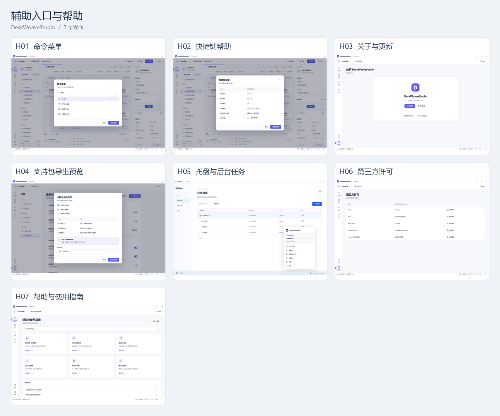

| 编号 | 界面与设计图 | 操作任务 | 主要操作与完成结果 |
|---|---|---|---|
| H01 | [命令菜单](../prototypes/images/H01-command-palette.png) · [交互](../prototypes/index.html#command-palette) | 通过搜索执行可用的工作台操作。 | 开始录制：录制准备 |
| H02 | [快捷键帮助](../prototypes/images/H02-shortcuts-help.png) · [交互](../prototypes/index.html#shortcuts-help) | 查看有效快捷键与当前键盘导航方式。 | 编辑快捷键：快捷键与冲突 |
| H03 | [关于与更新](../prototypes/images/H03-about.png) · [交互](../prototypes/index.html#about) | 查看组件版本、更新与帮助入口。 | 检查更新：发现更新 |
| H04 | [支持包导出预览](../prototypes/images/H04-support-export.png) · [交互](../prototypes/index.html#support-export) | 核对文件范围与敏感字段处理后导出。 | 导出所选材料：诊断与支持 |
| H05 | [托盘与后台任务](../prototypes/images/H05-tray-menu.png) · [交互](../prototypes/index.html#tray-menu) | 查看后台运行，打开工作台或急停。 | 打开运行：运行监控 |
| H06 | [第三方许可](../prototypes/images/H06-thirdparty-notices.png) · [交互](../prototypes/index.html#thirdparty-notices) | 按组件查看发行内实际附带的许可文件。 | 返回关于：关于与更新 |
| H07 | [帮助与使用指南](../prototypes/images/H07-help-docs.png) · [交互](../prototypes/index.html#help-docs) | 按制作、录制、运行和恢复任务查阅帮助。 | 打开制作工作台：流程画布 |

## 主题、容量与通用状态

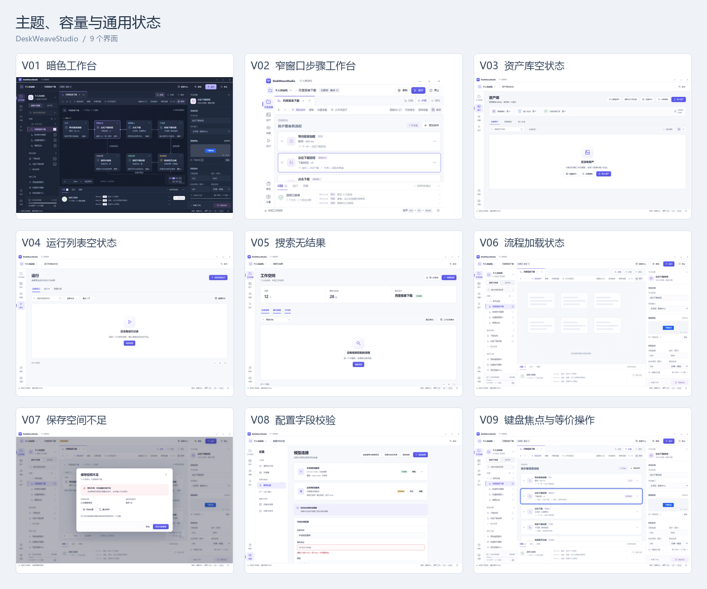

| 编号 | 界面与设计图 | 操作任务 | 主要操作与完成结果 |
|---|---|---|---|
| V01 | [暗色工作台](../prototypes/images/V01-editor-dark.png) · [交互](../prototypes/index.html#editor-dark) | 在暗色主题中查看完整编辑与运行入口。 | 打开外观设置：通用与外观 |
| V02 | [窄窗口步骤工作台](../prototypes/images/V02-editor-narrow.png) · [交互](../prototypes/index.html#editor-narrow) | 在 800×600 视口保留步骤和运行控制。 | 打开参数抽屉：参数与局部变量 |
| V03 | [资产库空状态](../prototypes/images/V03-assets-empty.png) · [交互](../prototypes/index.html#assets-empty) | 通过采集或导入建立第一份资产。 | 导入资产：导入资产 |
| V04 | [运行列表空状态](../prototypes/images/V04-runs-empty.png) · [交互](../prototypes/index.html#runs-empty) | 选择流程版本并创建首次运行。 | 选择流程：工作空间概览 |
| V05 | [搜索无结果](../prototypes/images/V05-search-empty.png) · [交互](../prototypes/index.html#search-empty) | 保留查询条件并允许清除筛选。 | 清除筛选：工作空间概览 |
| V06 | [流程加载状态](../prototypes/images/V06-editor-loading.png) · [交互](../prototypes/index.html#editor-loading) | 维持工作空间上下文，显示可取消读取。 | 查看加载结果：流程画布 |
| V07 | [保存空间不足](../prototypes/images/V07-storage-error.png) · [交互](../prototypes/index.html#storage-error) | 保留未保存草稿，选择导出或释放空间。 | 导出当前草稿：保存草稿副本 |
| V08 | [配置字段校验](../prototypes/images/V08-settings-validation.png) · [交互](../prototypes/index.html#settings-validation) | 在原字段显示原因并保留输入。 | 修正连接配置：编辑模型连接 |
| V09 | [键盘焦点与等价操作](../prototypes/images/V09-editor-focus.png) · [交互](../prototypes/index.html#editor-focus) | 通过可见焦点、步骤列表和连接菜单完成编辑。 | 查看键盘操作：快捷键帮助 |

## 跨平台与系统权限

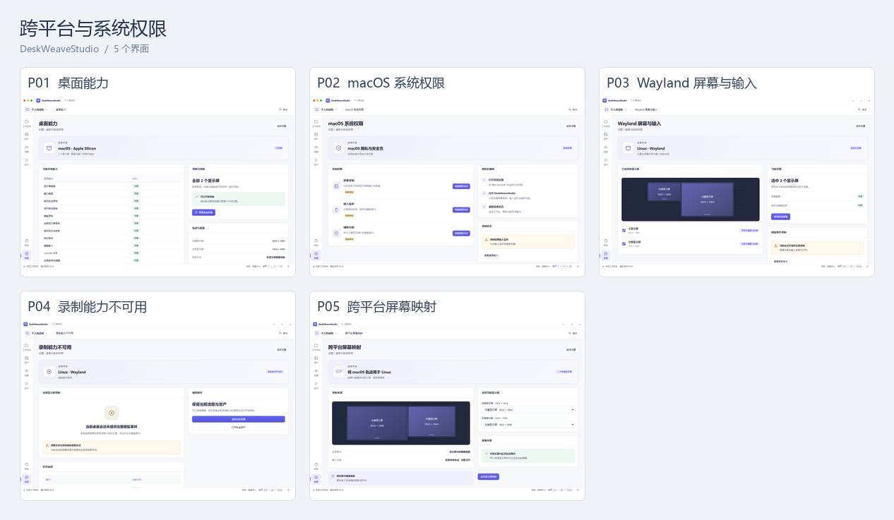

| 编号 | 界面与设计图 | 操作任务 | 主要操作与完成结果 |
|---|---|---|---|
| P01 | [桌面能力](../prototypes/images/P01-platform-capabilities.png) · [交互](../prototypes/index.html#platform-capabilities) | 查看当前平台的录制、采集、输入与桌面控制能力。 | 管理系统权限：macOS 系统权限 |
| P02 | [macOS 系统权限](../prototypes/images/P02-platform-macos-permissions.png) · [交互](../prototypes/index.html#platform-macos-permissions) | 分别处理屏幕录制、输入监听和辅助功能授权。 | 检查授权状态：更新对应权限、屏幕选择或映射状态。 |
| P03 | [Wayland 屏幕与输入](../prototypes/images/P03-platform-wayland-session.png) · [交互](../prototypes/index.html#platform-wayland-session) | 选择实际共享的屏幕，查看当前输入与录制能力。 | 使用所选屏幕：更新对应权限、屏幕选择或映射状态。 |
| P04 | [录制能力不可用](../prototypes/images/P04-platform-wayland-recording.png) · [交互](../prototypes/index.html#platform-wayland-recording) | 显示普通桌面全局录制不可用的具体原因和可用操作。 | 返回会话设置：Wayland 屏幕与输入 |
| P05 | [跨平台屏幕映射](../prototypes/images/P05-platform-display-mapping.png) · [交互](../prototypes/index.html#platform-display-mapping) | 按屏内像素映射跨平台轨迹，保持笔画形状与连续输入。 | 应用显示屏映射：更新对应权限、屏幕选择或映射状态。 |

## 需求覆盖

| 需求 | 对应画板 |
|---|---|
| DW-001 | W01、W02、W03、W04、W05、W06、W07、W08、W09、W10、O01、O02、O03、O04、O05、O06、O07、O08、O09、O10、O11、O12、O13 |
| DW-002 | E01、E02、E03、E04、E05、E06、E07、E08、E09、E10、E11、E12、E13、E14、E15、E23、E24、F01、F02、F03、F04、F05、F06、F07、F08、F09、F10、F11、F12、F13、F14、F15、F16、F17、F18、F19、F20、F21 |
| DW-003 | W01、W02、W03、W04、W05、W06、W07、W08、W09、E01、E02、E03、E04、E05、E06、E07、E08、E09、E10、E11、E12、E13、E14、E15、E17、E27、E28、E29、E30 |
| DW-004 | R01、R02、R03、R04、R05、R06、R07、R08、R09、R10、R11、R12、R15、R16、R17、R18、R19、R22、R23、R24、R25、R26、A14、P01、P02、P03、P04、P05 |
| DW-005 | R01、R02、R03、R04、R05、R06、R07、R08、R09、R10、R11、R12、R13、R14、R15、R16、R17、R20、R21、T01、T02、T03、T04、T05、T06、T07、T08、T09、T10、T11、T12、T13、T14、T15、T16、T17、T18、T19、T20、A01、A02、A03、A04、A05、A06、A07、A08、A09、A14 |
| DW-006 | E01、E02、E03、E04、E05、E06、E07、E08、E09、E10、E11、E12、E13、E14、E15、E25、E26、F01、F02、F03、F04、F05、F06、F07、F08、F09、F10、F11、F12、F13、F14、F15、F16、F17、F18、F19、F20、F21 |
| DW-007 | E01、E02、E03、E04、E05、E06、E07、E08、E09、E10、E11、E12、E13、E14、E15、F01、F02、F03、F04、F05、F06、F07、F08、F09、F10、F11、F12、F13、F14、F15、F16、F17、F18、F19、F20、F21 |
| DW-008 | E01、E02、E03、E04、E05、E06、E07、E08、E09、E10、E11、E12、E13、E14、E15、E27、A15、U01、U02、U03、U04、U05、U06、U07、U08、U09、U10、U11、U12、U13、U14、U15、U21、U22 |
| DW-009 | U01、U02、U03、U04、U05、U06、U07、U08、U09、U10、U11、U12、U13、U14、U15、U19、U20 |
| DW-010 | U01、U02、U03、U04、U05、U06、U07、U08、U09、U10、U11、U12、U13、U14、U15 |
| DW-011 | U01、U02、U03、U04、U05、U06、U07、U08、U09、U10、U11、U12、U13、U14、U15、U21、U22、U23、U24、U25 |
| DW-012 | T01、T02、T03、T04、T05、T06、T07、T08、T09、T10、T11、T12、T13、T14、T15、T16、T17、T18、T19、T20、A01、A02、A03、A04、A05、A06、A07、A08、A09、A10、A11、A12、A13、A14、A15、A16 |
| DW-013 | E29、S01、S02、S03、S04、S05、S06、S07、S08、S09、S10、C15、C16、C20、C21、C22 |
| DW-014 | R01、R02、R03、R04、R05、R06、R07、R08、R09、R10、R11、R12、R15、R16、R17、B01、B02、B03、B04、B05、B06、B07、B08、B09、B10、B11、B12、B13、B14、B15、B16、B17、B18、B19、B20、B21、B22、S01、S02、S03、S04、S05、S06、S07、S08、S09、S10 |
| DW-015 | O01、O02、O03、O04、O05、O06、O07、O08、O09、O10、O11、O12、O13、P01、P02、P03、P04、P05 |
| DW-016 | E23、E24、E25、E26、R18、R19、R20、R21、R22、R23、R24、R25、R26、S01、S02、S03、S04、S05、S06、S07、S08、S09、S10、S11、S12、H01、H02、H03、H04、H05、H06、H07、V01、V02、V03、V04、V05、V06、V07、V08、V09、P01、P02、P03、P04、P05 |
| DW-017 | O01、O02、O03、O04、O05、O06、O07、O08、O09、O10、O11、O12、O13、O14、O15、O16 |
| DW-018 | E17、S01、S02、S03、S04、S05、S06、S07、S08、S09、S10、O01、O02、O03、O04、O05、O06、O07、O08、O09、O10、O11、O12、O13、H01、H02、H03、H04、H05、H06、H07、V01、V02、V03、V04、V05、V06、V07、V08、V09 |
| DW-019 | R22、R23、R24、R25、R26、U01、U02、U03、U04、U05、U06、U07、U08、U09、U10、U11、U12、U13、U14、U15、U19、U20 |
| DW-020 | H01、H02、H03、H04、H05、H06、H07 |
| DW-021 | T01、T02、T03、T04、T05、T06、T07、T08、T09、T10、T11、T12、T13、T14、T15、T16、T17、T18、T19、T20 |
| DW-022 | T01、T02、T03、T04、T05、T06、T07、T08、T09、T10、T11、T12、T13、T14、T15、T16、T17、T18、T19、T20 |
| DW-023 | B01、B02、B03、B04、B05、B06、B07、B08、B09、B10、B11、B12、B13、B14、B15、B16、B17、B18、B19、B20、B21、B22 |
| DW-024 | B01、B02、B03、B04、B05、B06、B07、B08、B09、B10、B11、B12、B13、B14、B15、B16、B17、B18、B19、B20、B21、B22 |
| DW-025 | S13、S14、S15、C01、C02、C03、C04、C05 |
| DW-026 | E18、F22、F23、F24、U16、U17、U18、U23 |
| DW-027 | E16、E19、E20、E21 |
| DW-028 | C06、C07、C08、C09、C10、C11、C12、C13、C14、C15、C16、C17、C18、C19、C20、C21、C22 |
| DW-029 | E22、F25、U19 |
| DW-030 | P01、P02、P03、P04、P05 |
| DW-N01 | W01、R08、S03 |
| DW-N02 | B01、B02、B03、B04、B05、B06、B07、B08、B09、B10、B11、B12、B13、B14、B15、B16、B17、B18、B19、B20、B21、B22、U23、U25、S01、S02、S03、S04、S05、S06、S07、S08、S09、S10、S13 |
| DW-N03 | V01、V02、V03、V04、V05、V06、V07、V08、V09 |
| DW-N04 | O01、O02、O03、O04、O05、O06、O07、O08、O09、O10、O11、O12、O13 |
| DW-N05 | W10、E29、E30、O01、O02、O03、O04、O05、O06、O07、O08、O09、O10、O11、O12、O13、P01、P02、P03、P04、P05 |
| DW-N06 | V01、V02、V03、V04、V05、V06、V07、V08、V09 |

## 使用与验收

逐图检查中文可读性、主操作位置、字段错误、状态含义与退出路径；分别验证页面切换、搜索、表单、键盘、急停确认、暗色和窄窗口。
静态图与交互源保持同一版；图像、页面和交互的检查入口见[原型检查](../quality/prototype-validation.md)。
